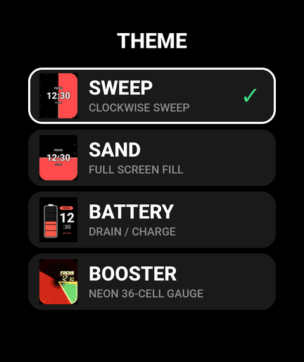
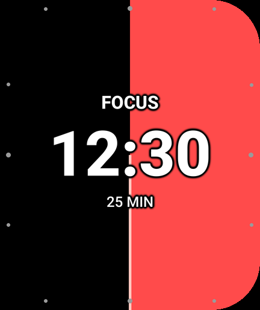
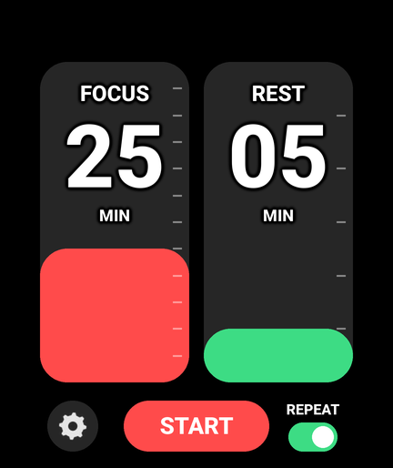
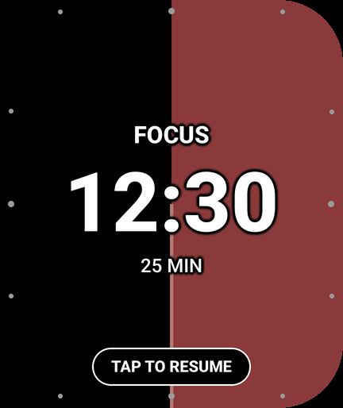
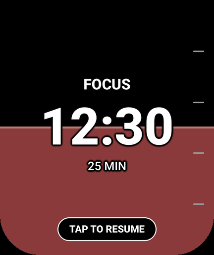
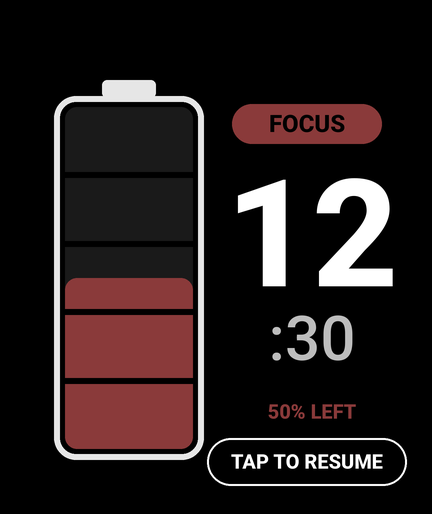
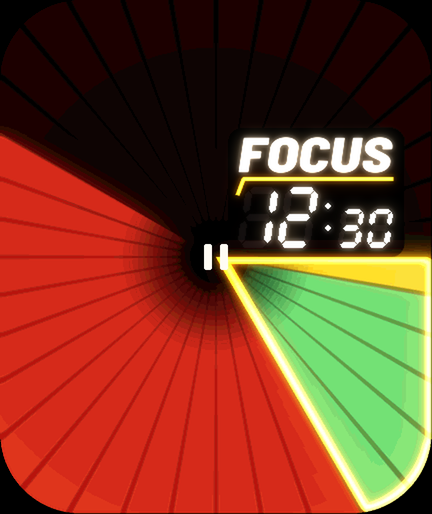

# BOOST (pomodoro)

REDMI Watch 6 글로벌(`M2523W1`, 펌웨어 `3.200.085`, 화면 432×514)용 Vela JS 퀵앱 **BOOST**입니다(런처 표시 이름). 집중과 휴식을 번갈아 재는 타이머입니다. 시작 전에 설정 화면에서 집중 시간(5~60분), 휴식 시간(1~30분), 반복 여부, 타이머 테마를 고릅니다.

- 패키지: `com.hun4175.pomodoro` · 버전 `0.1.10` (versionCode 11)
- 산출물: [`dist/com.hun4175.pomodoro.debug.0.1.10.rpk`](dist/) (toolkit 내장 디버그 서명, 자세한 정보는 [`dist/BUILD_INFO.md`](dist/BUILD_INFO.md))
- 0.1.10은 실기기 설치·확인 전입니다.

| 테마 고르기 (0.1.10 순서) | SWEEP (기본) | 설정 |
|---|---|---|
|  |  |  |

일시정지(백그라운드에서 돌아온 화면 포함):

| SWEEP | SAND | BATTERY | BOOSTER |
|---|---|---|---|
|  |  |  |  |

테마별 집중·휴식, 설정 변경 중·반복 끔 화면은 0.1.9와 같습니다:
[SAND 집중](docs/preview-0.1.9-sand-focus.png) · [SAND 휴식](docs/preview-0.1.9-sand-rest.png) ·
[BATTERY 집중](docs/preview-0.1.9-battery-focus.png) · [BATTERY 휴식](docs/preview-0.1.9-battery-rest.png) ·
[BOOSTER 집중](docs/preview-0.1.9-booster-focus.png) · [BOOSTER 휴식](docs/preview-0.1.9-booster-rest.png) ·
[SWEEP 휴식](docs/preview-0.1.9-sweep-rest.png) · [설정 변경 중](docs/preview-0.1.9-setup-changing.png) · [반복 끔](docs/preview-0.1.9-setup-repeat-off.png)

## 기능

- **설정 화면(TWIN TUBES, 모든 테마 공통)**: 앱을 켜면 설정 화면부터 나옵니다(저장된 타이머 세션이 있으면 그 타이머가 일시정지 상태로 나옴, 아래 "백그라운드"). 디자인 기준은 [`docs/full-theme-design/settings-merged/A-final`](docs/full-theme-design/settings-merged/A-final/)입니다.
  - 세로 튜브 두 개: 왼쪽 `FOCUS`(빨강, 12칸 = 5~60분, 5분 단위, 기본 25), 오른쪽 `REST`(초록, 30칸 = 1~30분, 1분 단위, 기본 5). 튜브 안 위쪽에 두 자리 숫자, 아래에서 위로 차오르는 채움이 값을 보여 줍니다.
  - **튜브를 짚으면 그 높이 칸 값으로 바로 바뀌고, 짚은 채 위아래로 끌면 칸마다 따라갑니다.** 칸 계산은 `k = clamp(ceil((420 − y) × n / 352), 1, n)`(n = 12 또는 30, 튜브 y 68~420)입니다. 튜브 밖으로 끌어도 끝값에서 멈추고, 바꾸는 중인 튜브는 테두리가 밝아집니다.
  - 조작은 전부 세로입니다. 처음 12px 움직임으로 축을 잠그고, 가로로 잠기면 값을 바꾸지 않습니다. 왼쪽 가장자리 x<30에서 시작한 터치는 무시합니다(시스템 뒤로가기용). 컨트롤을 만지는 중이거나 손 뗀 뒤 0.4초 안의 `onBackPress`는 삼킵니다.
  - 오른쪽 아래 `REPEAT` 글자 아래 토글을 탭하면 반복이 켜지고 꺼집니다(기본 켬). 끄면 집중과 휴식을 한 번씩 한 뒤 진동하고 설정 화면으로 돌아옵니다.
  - 아래 가운데 `START`를 탭하면 선택한 테마의 시작 애니메이션(약 0.9초) 뒤에 카운트다운이 시작됩니다.
  - **왼쪽 아래 톱니 버튼**(지름 56px, 터치 영역 80×68)을 탭하면 같은 페이지 안의 테마 목록(`THEME`)이 나옵니다. 4종이 1 SWEEP · 2 SAND · 3 BATTERY · 4 BOOSTER 순서로 이름·한 줄 설명·미리보기 썸네일과 함께 보이고, 현재 테마에 흰 테두리와 ✓가 붙습니다. 하나를 탭하면 저장하고 설정 화면으로 돌아오고, 시스템 뒤로가기도 설정 화면으로 돌아옵니다(앱이 닫히지 않음).
  - 집중·휴식·반복·테마는 `@system.storage`의 `pomodoro.settings.v1`에 저장되어 다음 실행에도 그대로 나옵니다. 테마는 이름 문자열(`"sweep"`, `"sand"` …)로 저장하므로 목록 순서가 바뀌어도 이미 고른 테마는 그대로입니다. 저장된 테마가 없으면(0.1.8 이전 저장값 포함) 기본 SWEEP입니다.
- **타이머 테마** (디자인 기준 [`docs/full-theme-design`](docs/full-theme-design/))
  - **SWEEP**(기본): 화면 중앙을 중심으로 12시에서 시계 방향으로 줄어드는 부채꼴(각도 = 남은 비율 × 360°). 기본은 CSS `transform: rotate` 방식이고, 실기기에서 안 되면 PNG 60프레임 방식으로 바꿀 수 있습니다(아래 "SWEEP 방식").
  - **SAND**: 화면 전체 채움이 위에서부터 비워집니다(높이 = 남은 비율 × 514px). 집중 빨강, 휴식 초록. 가운데 라벨·`MM:SS`·전체 시간.
  - **BATTERY**: 왼쪽 세로 배터리. 집중은 남은 비율만큼 닳고, 휴식은 지난 비율만큼 충전됩니다(안쪽 342px). 오른쪽에 라벨, 큰 분, `:초`, `NN% LEFT`/`CHARGING NN%`.
  - **BOOSTER**: 0.1.8까지의 부스터 계기판 그대로입니다. 원형 게이지 36칸(집중 30 + 휴식 6) PNG 37장 중 하나를 `image src` 교체로 보여 줍니다.
  - 공통: 탭하면 일시정지/재개(일시정지 중에는 SAND·BATTERY·SWEEP 채움 색이 어두워지고 아래쪽에 `TAP TO RESUME` 표시, BOOSTER는 게이지 중심에 막대 두 개), **길게 누르면(0.56초)** 설정 화면으로 돌아갑니다.
- **구간이 끝나면** `vibrate({ mode: 'long' })`를 0·500·1000ms에 총 3회 울리고 다음 구간으로 넘어갑니다.
- **백그라운드(0.1.10)**: 앱이 숨겨지면(페이지 `onHide`, 예: 다른 앱·홈으로 이동) 초기화하지 않습니다. 타이머는 그 순간 **일시정지**되고 남은 시간·집중/휴식 단계·반복 설정·테마·보고 있던 화면(설정·테마 목록·타이머)이 그대로 남습니다. 숨겨진 동안에는 시간이 줄지 않고 진동도 울리지 않습니다. 돌아오면(`onShow`) 같은 화면에 일시정지 상태로 보이고, 화면을 탭해야 이어서 갑니다.
  - 타이머 세션은 `@system.storage`의 `pomodoro.session.v1`에도 저장합니다(숨길 때, 시작·일시정지·재개 때). 앱 프로세스가 완전히 종료됐다가 다시 켜지면 저장된 세션을 **일시정지 상태로 복원**합니다. 실행 중으로 저장된 채 끝났다면(숨김 처리 없이 종료) 그 사이 지난 시간만큼 진행한 뒤 일시정지로 보여 줍니다.
  - 길게 눌러 설정으로 가거나 반복 끔 세션이 끝나면 저장 세션을 지우고, 다음 실행은 설정 화면부터입니다.
- **시간 계산**: 끝나는 시각(`Date.now()` 기준)을 잡아 두고 남은 시간을 매번 그 시각에서 다시 계산합니다.
- **화면 켜짐 유지**: 실행 중에는 `@system.brightness`의 `setKeepScreenOn({ keepScreenOn: true })`를 시도하고, 정지·일시정지·설정으로 돌아갈 때 해제합니다.

설정·테마 목록·타이머는 한 페이지 안의 세 뷰(`view === 'setup'` / `'themes'` / `'timer'`)입니다. 페이지를 나누면 이동할 때도 `onShow`가 불려 "백그라운드에서 돌아옴"과 구분할 수 없고, `router.back`으로 앱이 닫힐 수 있어서 한 페이지로 두었습니다. SAND·BATTERY·SWEEP와 설정 화면은 CSS(div 크기·색·위치 바인딩)로 그리고, BOOSTER만 PNG를 씁니다.

### SWEEP 방식

- `src/common/timer.js`의 `SWEEP_MODE`가 `'rotate'`(기본)면 div 4개(고정 반원, 회전 마스크, 회전 반원, 경계선)를 `transform: rotate(...)`·`transform-origin`으로 돌립니다. 근거: [Vela 애니메이션 스타일 문서](https://iot.mi.com/vela/quickapp/zh/components/general/animation-style.html)에 `transform`(rotate)과 `transform-origin`(px)이 있고, aiot-toolkit 2.0.5가 이 스타일을 검사·컴파일합니다. **실기기 확인은 아직 하지 않았습니다.**
- 실기기에서 부채꼴이 돌지 않거나 모양이 깨지면 아래처럼 PNG 60프레임(구간당, `docs/full-theme-design/08-sweep/assets`) 방식으로 바꿔 다시 빌드합니다. rpk가 약 140KB 커집니다(0.1.9 기준 950491 → 1091806 bytes 측정).

```bash
python3 scripts/sweep-mode.py frames   # SWEEP_MODE='frames' + src/common/sweep/ 프레임 120장 복사
python3 scripts/sweep-mode.py rotate   # 되돌리기(프레임 폴더 삭제)
```

## 하지 않는 것

- 소리, `audio`, `muted`, 볼륨 API는 쓰지 않습니다. 미니드럼 0.1.0에서 `muted`를 쓰니 시스템 미디어 볼륨이 0이 되는 현상을 확인한 적이 있습니다.
- 다른 앱으로 이동(`router`)하지 않습니다.

## 알려진 제약 · 미확인

**사실 (문서 또는 다른 앱의 실기기 확인)**
- 화면 기준은 **432×514** 둥근 사각형입니다(모서리 반지름 80px 안쪽에 버튼을 둠).
- 진동은 `vibrate({ mode: 'long' | 'short' })`만 사용합니다. Watch 6은 `start`/`stop`을 지원하지 않았습니다(염주 앱 실기기 확인).
- 인라인 `style="left: {{x}}px"` 같은 스타일 바인딩과 ✓ 글자는 염주 앱에서 실기기로 확인된 방식입니다.
- [`@system.brightness.setKeepScreenOn`](https://iot.mi.com/vela/quickapp/zh/features/system/brightness.html)는 문서에 있는 API입니다.

**미확인 (실기기 확인 필요)**
- **SWEEP rotate**: div에 `transform: rotate` + `transform-origin`(px)이 먹는지, 화면보다 큰 div(338×676, top −81)가 잘리지 않고 그려지는지, 1초마다 회전값을 바꿀 때 바로 반영되는지.
- 1초마다 div 높이·색을 바꾸는 SAND·BATTERY가 바로 반영되는지, 시작 애니메이션(50ms 간격)이 부드러운지.
- 시스템 글꼴의 큰 숫자(최대 150px)·세로 정렬이 미리보기(Roboto로 그림)와 비슷하게 보이는지. 테두리 없는 `border-radius` 모양.
- 휴식 튜브 칸 높이가 약 11.7px라 손가락으로 한 칸씩 고르기 괜찮은지. 튜브 위쪽(y≈64~68)에서 아래로 끌 때 시스템 내려 당기기가 가로채는지.
- **화면이 꺼질 때 페이지 `onHide`/`onShow`가 불리는지**. 불린다면 화면이 꺼질 때마다 타이머가 일시정지되고, 켜면 탭해서 재개해야 합니다(실행 중에는 화면 켜짐 유지를 시도함).
- 백그라운드 일시정지·복원은 node 시뮬레이션 테스트로만 확인했습니다(추정). 홈·다른 앱으로 갈 때 실제로 `onHide`가 불리는지, 앱이 종료될 때 `onHide`/`onDestroy` 안의 `storage.set`(비동기)이 끝나는지, 시스템이 앱을 언제 종료하는지는 실기기 확인이 필요합니다. 저장이 안 됐다면 마지막으로 저장된 시점(시작·일시정지·재개)의 세션으로 복원됩니다.
- 튜브를 비스듬히 오른쪽으로 끌 때 시스템 "뒤로"가 먼저 먹는지, 테마 목록에서 뒤로가기가 설정 화면으로 돌아오는지(앱이 닫히지 않는지), 톱니 버튼이 잘 눌리는지.
- 길게 누르기 판정 시간(560ms)이 손에 맞는지.

## 빌드 · 테스트

```bash
cd pomodoro
npm install
npm run preview  # 아이콘, BOOSTER 게이지, 톱니·썸네일, 0.1.10 미리보기 PNG 다시 생성 (선택)
npm test         # node:test 단위 테스트
npm run build    # dist/com.hun4175.pomodoro.debug.0.1.10.rpk
```

`sign/` 폴더가 없으면 aiot-toolkit 내장 디버그 인증서(CN=localhost)로 서명됩니다.  
0.1.10은 릴리즈 서명을 하지 않았습니다. `npm run release`는 `dist/`를 지울 수 있어 넣지 않았습니다.

아이콘은 확정 시안 `docs/icon-design/A/icon-192.png`(생성기 `docs/icon-design/gen_icons.py`)를 `scripts/gen-preview.py`가 `src/common/logo.png`로 복사합니다. BOOSTER 게이지 PNG는 `scripts/gen-booster.py`, 톱니·테마 썸네일과 `docs/preview-0.1.10-*.png`는 `scripts/gen-preview-ui.py`(Python / Pillow, 0.1.9 때 이름은 `gen-preview-0.1.9.py`)가 만듭니다. 미리보기는 `scripts/render-tree.mjs`가 실제 `index.ux` 템플릿·스타일과 `timer.js` 값을 평가한 결과를 그린 것이고, 실기기 화면 캡처가 아닙니다. `index.ux`의 템플릿·스타일은 `scripts/gen-index-ux.py`가 디자인 좌표로 생성합니다.

## 설치

`.rpk`를 워치에 올리는 방법은 기기·지역·Mi Fitness 버전에 따라 다를 수 있습니다.

공식 FAQ의 **디버그 / 서드파티 앱** 안내를 참고하세요:

- [Vela Quick App FAQ](https://iot.mi.com/vela/quickapp/en/guide/other/faq.html)

서명 우회·기기에 직접 쓰는 스크립트는 제공하지 않습니다.

앱 목록에서 **BOOST**를 실행하면 설정 화면이 나옵니다. 두 튜브를 짚거나 위아래로 끌어 집중·휴식 값을 고르고, 왼쪽 아래 톱니로 테마를 고른 뒤 `START`를 탭하면 시작합니다. 타이머 화면은 탭하면 일시정지/재개, 길게 누르면 설정 화면으로 돌아갑니다. 앱을 나갔다 오면 타이머는 일시정지 상태로 기다립니다.

## 라이선스

MIT. [`LICENSE`](LICENSE) 참고.

## 변경 이력

- **0.1.10**: 테마 순서를 1 SWEEP(기본) · 2 SAND · 3 BATTERY · 4 BOOSTER로 변경(이미 고른 테마는 유지). 백그라운드로 가도 초기화하지 않고 일시정지 상태로 보존(남은 시간·단계·화면), 돌아오면 탭으로 재개. 앱이 다시 켜져도 저장된 세션을 일시정지 상태로 복원.
- **0.1.9**: 테마 4종(SAND 기본·BOOSTER·BATTERY·SWEEP)과 왼쪽 아래 톱니 → 테마 목록 추가(설정에 `theme` 저장). 설정 화면을 공통 TWIN TUBES로 교체(세로 조작·축 잠금·뒤로가기 가드 유지). THERMO 설정 PNG 52장 제거로 rpk 약 1.28MB → 0.95MB.
- **0.1.8**: 앱 이름을 BOOST로 바꾸고 아이콘을 부채꼴 게이지(A SECTOR)로 교체. 패키지명·화면·조작·타이머는 그대로.
- **0.1.7**: 설정 화면을 세로 조작(THERMO)으로 교체. 오른쪽 세로 막대 두 개를 짚거나 위아래로 끌어 값을 고르고, 큰 숫자 윗절반·아랫절반 탭으로 한 단계씩 조정. 좌우 끌기 제거(오른쪽으로 끌면 앱이 닫히던 문제 대응). 타이머·시작 애니메이션·초기화 정책은 그대로.
- **0.1.6**: 시간 설정을 별도 설정 화면으로 분리(집중·휴식 큰 숫자를 좌우로 끌어 변경, 반복 토글, START). 시작하면 게이지가 0칸부터 차오른 뒤 카운트다운, 타이머 화면 길게 누르면 설정으로 복귀. 앱을 다시 켜거나 돌아오면 항상 설정부터 시작(설정값만 저장). 휴식 1~30분 설정 추가, 대기 힌트 제거.
- **0.1.5**: 휴식 테두리 꼭짓점을 화면 중심으로 옮겨, 마지막 집중 칸과 첫 휴식 칸도 다른 칸과 같은 파이 조각 모양이 되도록 수정. 그 밖의 디자인·조작·타이머는 그대로.
- **0.1.4**: 계기판 색·선·글로우를 원작 느낌으로 다듬음(평평한 셀 레드, 파스텔 그린, 노란 네온 2단 헤일로, 가는 7세그먼트, 굵은 이탤릭 라벨). 휴식 테두리의 중심 쪽 끝을 뾰족하게, FOCUS/REST 밑줄 왼쪽 끝을 중심 쪽으로 꺾고, 휴식 마지막 칸(3시 바로 아래)을 노랑으로 표시. 배치·조작·타이머는 그대로.
- **0.1.3**: 화면을 사이버포뮬러 부스터 계기판 스타일로 교체. 원형 게이지 36칸(집중 30 + 휴식 6)이 3시 방향부터 시계 반대 방향으로 꺼지고, 우상단에 FOCUS/REST 라벨과 7세그먼트 시간 표시. 대기 힌트는 `^ 5~60 v`. 게이지는 미리 합성한 PNG 37장의 단일 `image` `src` 교체. 조작·타이머·진동은 그대로.
- **0.1.2**: 대기 화면에 시간 위·아래 화살표 인디케이터 추가. 집중이 줄어든 위쪽은 휴식 초록으로 채우고, 휴식 구간 위쪽은 검정으로 둠.
- **0.1.1**: 원형 링을 모래시계(화면 전체가 위에서 아래로 비워짐)로 교체. 대기 중 스와이프로 집중 시간 5~60분 설정. 링 프레임 에셋 제거.
- **0.1.0**: 첫 버전. 25/5 고정 사이클, 탭 시작·일시정지, 길게 눌러 리셋, 진동 3회, 끝시각 기준 계산, 상태 저장, 화면 켜짐 유지 시도, 원형 링 프레임.
