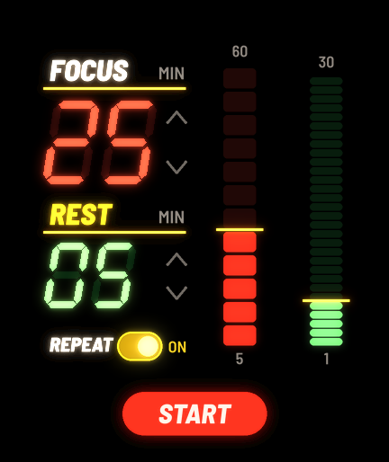
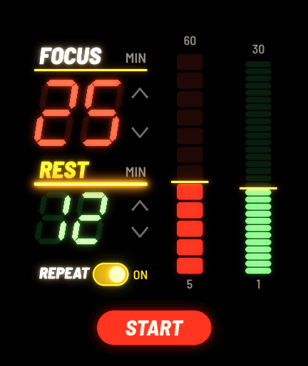
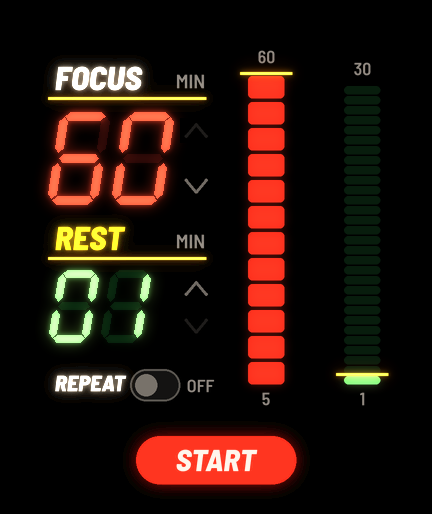
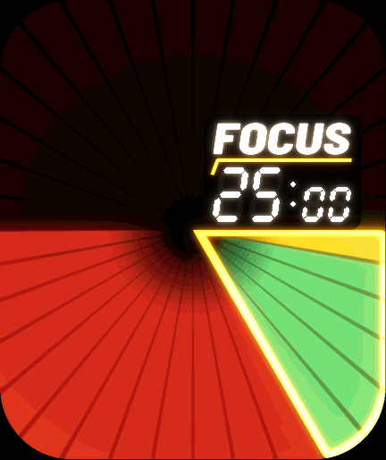
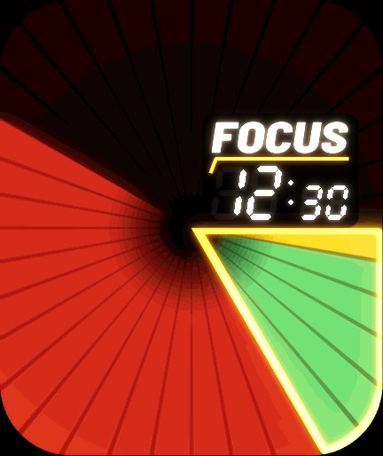
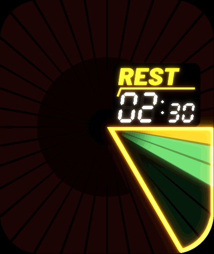

# BOOST (pomodoro)

REDMI Watch 6 글로벌(`M2523W1`, 펌웨어 `3.200.085`, 화면 432×514)용 Vela JS 퀵앱 **BOOST**입니다(런처 표시 이름). 집중과 휴식을 번갈아 재는 타이머입니다. 시작 전에 설정 화면에서 집중 시간(5~60분), 휴식 시간(1~30분), 반복 여부를 고릅니다.

- 패키지: `com.hun4175.pomodoro` · 버전 `0.1.8` (versionCode 9)
- 산출물: [`dist/com.hun4175.pomodoro.debug.0.1.8.rpk`](dist/) (toolkit 내장 디버그 서명, 자세한 정보는 [`dist/BUILD_INFO.md`](dist/BUILD_INFO.md))
- 0.1.8은 실기기 설치·확인 전입니다.








## 기능

- **설정 화면**: 앱을 켜면 항상 설정 화면부터 나옵니다.
  - 왼쪽에 `FOCUS`(빨강)와 `REST`(초록) 값을 7세그먼트 큰 숫자로, 오른쪽에 온도계처럼 차오르는 세로 막대 두 개(집중 12칸, 휴식 30칸)를 보여 줍니다.
  - **막대를 짚으면 그 높이 칸 값으로 바로 바뀌고, 짚은 채 위아래로 끌면 칸마다 따라갑니다.** 막대 밖으로 끌어도 끝값(5·60분, 1·30분)에서 멈춥니다. 바꾸는 줄의 밑줄이 밝아집니다.
  - **큰 숫자 칸의 윗절반을 탭하면 한 단계 늘고, 아랫절반을 탭하면 한 단계 줄어듭니다**(집중 ±5분, 휴식 ±1분). 숫자 칸에서 위아래로 쓸어도 36px마다 한 단계씩 바뀝니다(위로 = 늘림). 끝값에서는 그쪽 화살표가 흐려집니다.
  - 조작은 전부 세로입니다. 좌우로 끄는 동작은 값을 바꾸지 않고, 세로로 끄는 중에 손가락이 오른쪽으로 비껴도 값만 바뀝니다(그동안 시스템 뒤로가기는 막음).
  - 집중은 5분 단위 5~60분(기본 25), 휴식은 1분 단위 1~30분(기본 5)입니다.
  - `REPEAT` 줄을 탭하면 반복이 켜지고 꺼집니다(기본 켬). 켜면 집중→휴식→집중…을 계속 돌고, 끄면 집중과 휴식을 한 번씩 한 뒤 진동하고 설정 화면으로 돌아옵니다.
  - `START`를 탭하면 설정 화면이 닫히고, 게이지가 0칸에서 36칸까지 약 0.9초 동안 시계 방향으로 차오른 뒤 카운트다운이 시작됩니다.
  - 마지막으로 고른 집중·휴식·반복 값은 저장되어 다음 설정 화면에 그대로 나옵니다.
- **타이머 화면(부스터 계기판)**: 화면 중심에서 퍼지는 원형 게이지 36칸(10°씩)에 집중 30칸(빨강)과 휴식 6칸(초록, 3~5시 방향, 노란 네온 테두리, 3시 바로 아래 마지막 칸만 노랑)을 함께 표시합니다. 시간이 지나면 3시 방향 칸부터 시계 반대 방향으로 꺼집니다. 켜진 칸 수는 집중이 `휴식 6칸 + ceil(남은 비율×30)`, 휴식이 `ceil(남은 비율×6)`입니다. 우상단에 `FOCUS` / `REST` 라벨과 7세그먼트 `MM:SS`를 표시합니다.
  - 탭하면 일시정지/재개가 바뀌고, 일시정지일 때는 게이지 중심에 막대 두 개가 보입니다.
  - **길게 누르면(0.56초)** 타이머를 멈추고 설정 화면으로 돌아갑니다. 시작 애니메이션 중에도 같습니다.
- **구간이 끝나면** `vibrate({ mode: 'long' })`를 0·500·1000ms에 총 3회 울리고 다음 구간으로 넘어갑니다.
- **초기화**: 앱을 새로 켜거나, 다른 화면에 갔다가 돌아오면(페이지 `onShow`) 진행 중이던 타이머는 버리고 항상 설정 화면부터 시작합니다. 진행 상태는 저장하지 않고, 설정값만 `@system.storage`에 저장합니다.
- **시간 계산**: 끝나는 시각(`Date.now()` 기준)을 잡아 두고 남은 시간을 매번 그 시각에서 다시 계산합니다.
- **화면 켜짐 유지**: 실행 중에는 `@system.brightness`의 `setKeepScreenOn({ keepScreenOn: true })`를 시도하고, 정지·일시정지·설정으로 돌아갈 때 해제합니다. API가 없거나 실패해도 앱이 죽지 않게 했습니다.

설정 화면과 타이머 화면은 한 페이지 안의 두 뷰(`view === 'setup'` / `'timer'`)입니다. 페이지를 나누면 설정↔타이머 이동 때도 `onShow`가 불려 "백그라운드에서 돌아옴"과 구분할 수 없어서 한 페이지로 두었습니다. 게이지는 켜진 칸 수(0~36)별로 미리 합성한 전체 화면 PNG 37장(`src/common/booster/g00~g36.png`, 256색 팔레트) 중 하나를 **단일 `image`의 `src` 교체**로 보여 주고, 시작 애니메이션도 같은 방식으로 50ms마다 `src`를 바꿉니다. 설정 화면은 정적 배경 PNG 한 장(`src/common/setup/bg.png`) 위에 숫자·막대 묶음·토글 투명 PNG를 겹치고 `src`와 `if`만 바꿉니다(막대는 묶음 이미지 22장을 노드 5개가 나눠 씀). 리소스와 미리보기는 `scripts/gen-booster.py`(타이머)와 `scripts/gen-setup.py`(설정)가 디자인 기준 `docs/booster-design/v11/gen_v11.py`, `docs/booster-design/setup-final-thermo/gen_setup_thermo.py`를 불러 생성합니다. 라벨 글꼴 Barlow Semi Condensed(SIL Open Font License 1.1)는 PNG에 구워 넣었고, 글꼴 파일은 레포·rpk에 넣지 않습니다.

## 하지 않는 것

- 소리, `audio`, `muted`, 볼륨 API는 쓰지 않습니다. 미니드럼 0.1.0에서 `muted`를 쓰니 시스템 미디어 볼륨이 0이 되는 현상을 확인한 적이 있습니다.
- 다른 앱으로 이동(`router`)하지 않습니다.

## 알려진 제약 · 미확인

**사실 (문서 또는 다른 앱의 실기기 확인)**
- 화면 기준은 **432×514** 둥근 사각형입니다.
- 진동은 `vibrate({ mode: 'long' | 'short' })`만 사용합니다. Watch 6은 `start`/`stop`을 지원하지 않았습니다(염주 앱 실기기 확인).
- [`@system.brightness.setKeepScreenOn`](https://iot.mi.com/vela/quickapp/zh/features/system/brightness.html)는 문서에 있는 API입니다.

**미확인 (실기기 확인 필요)**
- **화면이 꺼질 때 페이지 `onHide`/`onShow`가 불리는지** 모릅니다. 불린다면 화면이 꺼졌다 켜질 때마다 타이머가 초기화되어 설정 화면으로 돌아갑니다. 실행 중에는 화면 켜짐 유지를 시도하지만, 이 기기에서 `setKeepScreenOn`이 실제로 화면을 켜 두는지도 아직 모릅니다.
- **설정 화면에서 막대를 비스듬히 오른쪽으로 끌 때 시스템 "뒤로"가 먼저 먹는지** 모릅니다. 설정 컨트롤을 만지는 중이거나 손 뗀 뒤 0.4초 안의 `onBackPress`는 삼키도록 했습니다(컨트롤이 없는 왼쪽 가장자리에서 시작한 스와이프는 그대로 뒤로가기).
- **막대 위쪽 끝(y≈56)에서 아래로 끌 때 시스템 내려 당기기(알림·제어 화면)가 가로채는지** 모릅니다. 가로채면 그때까지 바뀐 값은 남고 저장됩니다.
- 막대를 끌 때 `src` 교체(막대 묶음 + 숫자 두 자리)가 버벅이지 않는지, 휴식 막대 칸 높이 10px가 손가락으로 짚기에 괜찮은지 모릅니다(정확한 값은 숫자 칸 탭으로 맞추는 흐름).
- 시작 애니메이션(50ms마다 게이지 `src` 교체)이 이 기기에서 부드럽게 보이는지 모릅니다. 경과 시간으로 칸 수를 계산하므로 느리면 칸을 건너뛰지만 끝나는 시점은 같습니다.
- 길게 누르기 판정 시간(560ms)과 숫자 칸 쓸기 간격(36px)이 손에 맞는지 모릅니다.
- 게이지 PNG `src` 교체와 숫자 이미지 교체가 1초마다 바로 반영되는지, 투명 PNG 겹침이 미리보기처럼 보이는지 모릅니다. rpk가 약 1.2MB여서 설치·로딩 시간도 확인이 필요합니다.

## 빌드 · 테스트

```bash
cd pomodoro
npm install
npm run preview  # 아이콘, 게이지·숫자 리소스, 미리보기 PNG 다시 생성 (선택)
npm test         # node:test 단위 테스트
npm run build    # dist/com.hun4175.pomodoro.debug.0.1.8.rpk
```

`sign/` 폴더가 없으면 aiot-toolkit 내장 디버그 인증서(CN=localhost)로 서명됩니다.  
0.1.8은 릴리즈 서명을 하지 않았습니다. `npm run release`는 `dist/`를 지울 수 있어 넣지 않았습니다.

아이콘은 확정 시안 `docs/icon-design/A/icon-192.png`(생성기 `docs/icon-design/gen_icons.py`)를 `scripts/gen-preview.py`가 `src/common/logo.png`로 복사하고, 화면 리소스·미리보기는 `scripts/gen-booster.py`(설정 화면 `scripts/gen-setup.py`까지 함께 실행, Python / Pillow)로 생성합니다.

## 설치

`.rpk`를 워치에 올리는 방법은 기기·지역·Mi Fitness 버전에 따라 다를 수 있습니다.

공식 FAQ의 **디버그 / 서드파티 앱** 안내를 참고하세요:

- [Vela Quick App FAQ](https://iot.mi.com/vela/quickapp/en/guide/other/faq.html)

서명 우회·기기에 직접 쓰는 스크립트는 제공하지 않습니다.

앱 목록에서 **BOOST**를 실행하면 설정 화면이 나옵니다. 오른쪽 막대를 짚거나 위아래로 끌어 집중·휴식 값을 고르고(큰 숫자 윗절반·아랫절반 탭으로 한 단계씩 조정) `START`를 탭하면 시작합니다. 타이머 화면은 탭하면 일시정지/재개, 길게 누르면 설정 화면으로 돌아갑니다.

## 라이선스

MIT. [`LICENSE`](LICENSE) 참고.

## 변경 이력

- **0.1.8**: 앱 이름을 BOOST로 바꾸고 아이콘을 부채꼴 게이지(A SECTOR)로 교체. 패키지명·화면·조작·타이머는 그대로.
- **0.1.7**: 설정 화면을 세로 조작(THERMO)으로 교체. 오른쪽 세로 막대 두 개를 짚거나 위아래로 끌어 값을 고르고, 큰 숫자 윗절반·아랫절반 탭으로 한 단계씩 조정. 좌우 끌기 제거(오른쪽으로 끌면 앱이 닫히던 문제 대응). 타이머·시작 애니메이션·초기화 정책은 그대로.
- **0.1.6**: 시간 설정을 별도 설정 화면으로 분리(집중·휴식 큰 숫자를 좌우로 끌어 변경, 반복 토글, START). 시작하면 게이지가 0칸부터 차오른 뒤 카운트다운, 타이머 화면 길게 누르면 설정으로 복귀. 앱을 다시 켜거나 돌아오면 항상 설정부터 시작(설정값만 저장). 휴식 1~30분 설정 추가, 대기 힌트 제거.
- **0.1.5**: 휴식 테두리 꼭짓점을 화면 중심으로 옮겨, 마지막 집중 칸과 첫 휴식 칸도 다른 칸과 같은 파이 조각 모양이 되도록 수정. 그 밖의 디자인·조작·타이머는 그대로.
- **0.1.4**: 계기판 색·선·글로우를 원작 느낌으로 다듬음(평평한 셀 레드, 파스텔 그린, 노란 네온 2단 헤일로, 가는 7세그먼트, 굵은 이탤릭 라벨). 휴식 테두리의 중심 쪽 끝을 뾰족하게, FOCUS/REST 밑줄 왼쪽 끝을 중심 쪽으로 꺾고, 휴식 마지막 칸(3시 바로 아래)을 노랑으로 표시. 배치·조작·타이머는 그대로.
- **0.1.3**: 화면을 사이버포뮬러 부스터 계기판 스타일로 교체. 원형 게이지 36칸(집중 30 + 휴식 6)이 3시 방향부터 시계 반대 방향으로 꺼지고, 우상단에 FOCUS/REST 라벨과 7세그먼트 시간 표시. 대기 힌트는 `^ 5~60 v`. 게이지는 미리 합성한 PNG 37장의 단일 `image` `src` 교체. 조작·타이머·진동은 그대로.
- **0.1.2**: 대기 화면에 시간 위·아래 화살표 인디케이터 추가. 집중이 줄어든 위쪽은 휴식 초록으로 채우고, 휴식 구간 위쪽은 검정으로 둠.
- **0.1.1**: 원형 링을 모래시계(화면 전체가 위에서 아래로 비워짐)로 교체. 대기 중 스와이프로 집중 시간 5~60분 설정. 링 프레임 에셋 제거.
- **0.1.0**: 첫 버전. 25/5 고정 사이클, 탭 시작·일시정지, 길게 눌러 리셋, 진동 3회, 끝시각 기준 계산, 상태 저장, 화면 켜짐 유지 시도, 원형 링 프레임.
