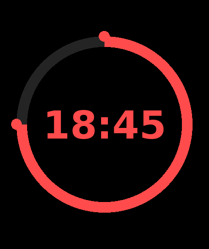

# 뽀모도로 (pomodoro)

REDMI Watch 6 글로벌(`M2523W1`, 펌웨어 `3.200.085`, 화면 432×514)용 Vela JS 퀵앱입니다. 25분 집중과 5분 휴식을 반복하는 타이머입니다.

- 패키지: `com.hun4175.pomodoro` · 버전 `0.1.0` (versionCode 1)
- 산출물: [`dist/com.hun4175.pomodoro.debug.0.1.0.rpk`](dist/) (toolkit 내장 디버그 서명, 자세한 정보는 [`dist/BUILD_INFO.md`](dist/BUILD_INFO.md))
- 0.1.0은 실기기 설치·확인 전입니다.



## 기능

- **고정 사이클**: 25분 집중 → 5분 휴식, 반복. 시간 설정·긴 휴식·세트 표시는 없습니다. 설정도 없습니다.
- **화면 하나**: 원형 진행 링과 큰 남은 시간(`MM:SS`)만 보입니다. 집중은 빨강, 휴식은 초록입니다.
- **대기·일시정지**: 대기(시작 전)와 일시정지는 링과 숫자를 어둡게 합니다. 일시정지일 때만 가운데 아래에 일시정지 막대 두 개가 붙습니다. 안내 글자는 없습니다.
- **조작**: 화면을 탭하면 시작/일시정지가 바뀝니다. 길게 누르면 확인 없이 바로 집중 대기(25:00)로 돌아갑니다.
- **구간이 끝나면** `vibrate({ mode: 'long' })`를 0·500·1000ms에 총 3회 울리고, 다음 구간을 자동으로 시작합니다.
- **시간 계산**: 끝나는 시각(`Date.now()` 기준)을 저장해 두고, 남은 시간은 매번 그 시각에서 다시 계산합니다. 앱을 나갔다 들어왔을 때 여러 구간이 지났으면 그만큼 진행합니다. 상태는 `@system.storage`에 저장합니다.
- **화면 켜짐 유지**: 실행 중에는 `@system.brightness`의 `setKeepScreenOn({ keepScreenOn: true })`를 시도하고, 정지·일시정지·화면을 떠날 때 해제합니다. API가 없거나 실패해도 앱이 죽지 않게 했습니다. 이 기기에서 실제로 화면이 유지되는지는 아직 모릅니다.

원형 링은 미리 합성한 PNG 프레임(집중·휴식 각 60장, 400×400)을 단일 `<image>`의 `src`만 바꿔 보여 줍니다. 여러 이미지 + `@keyframes` 방식은 염주 앱에서 실기기 지연이 약 1초였고, `image-animator`는 보이지 않았습니다.

## 하지 않는 것

- 소리, `audio`, `muted`, 볼륨 API는 쓰지 않습니다. 미니드럼 0.1.0에서 `muted`를 쓰니 시스템 미디어 볼륨이 0이 되는 현상을 확인한 적이 있습니다.
- 다른 앱으로 이동(`router`)하지 않습니다.

## 알려진 제약 · 미확인

**사실 (문서 또는 다른 앱의 실기기 확인)**
- 화면 기준은 **432×514** 둥근 사각형입니다. 링 이미지는 그 안에 맞춘 400×400입니다.
- 진동은 `vibrate({ mode: 'long' | 'short' })`만 사용합니다. Watch 6은 `start`/`stop`을 지원하지 않았습니다(염주 앱 실기기 확인).
- [`@system.brightness.setKeepScreenOn`](https://iot.mi.com/vela/quickapp/zh/features/system/brightness.html)는 문서에 있는 API입니다.

**미확인 (실기기 확인 필요)**
- **화면이 꺼진 뒤, 또는 앱을 나간 뒤에 타이머와 진동이 계속 도는지** 모릅니다. 퀵앱 JS가 백그라운드에서 멈출 가능성이 있습니다. 지금은 재진입 때 끝시각으로 구간을 따라잡고, 실행 중에는 화면 켜짐 유지를 시도합니다.
- 이 기기에서 `setKeepScreenOn`이 실제로 화면을 켜 두는지 모릅니다.
- 저장해 둔 상태를 재진입 때 복원하는 동작은 단위 테스트만 있고, 실기기에서는 아직 확인하지 않았습니다.
- 길게 누르기 판정 시간(560ms)이 이 기기에서 손에 맞는지 모릅니다.

## 빌드 · 테스트

```bash
cd pomodoro
npm install
npm run rings    # 링 프레임·아이콘·프리뷰 다시 합성 (선택)
npm test         # node:test 단위 테스트
npm run build    # dist/com.hun4175.pomodoro.debug.0.1.0.rpk
```

`sign/` 폴더가 없으면 aiot-toolkit 내장 디버그 인증서(CN=localhost)로 서명됩니다.  
0.1.0은 릴리즈 서명을 하지 않았습니다. `npm run release`는 `dist/`를 지울 수 있어 넣지 않았습니다.

링 프레임은 `scripts/gen-rings.py`(Python / Pillow)로 생성합니다.

## 설치

`.rpk`를 워치에 올리는 방법은 기기·지역·Mi Fitness 버전에 따라 다를 수 있습니다.

공식 FAQ의 **디버그 / 서드파티 앱** 안내를 참고하세요:

- [Vela Quick App FAQ](https://iot.mi.com/vela/quickapp/en/guide/other/faq.html)

서명 우회·기기에 직접 쓰는 스크립트는 제공하지 않습니다.

앱 목록에서 **뽀모도로**를 실행하면 됩니다. 화면을 탭해 시작하고, 길게 누르면 처음으로 돌아갑니다.

## 라이선스

MIT. [`LICENSE`](LICENSE) 참고.

## 변경 이력

- **0.1.0**: 첫 버전. 25/5 고정 사이클, 탭 시작·일시정지, 길게 눌러 리셋, 진동 3회, 끝시각 기준 계산, 상태 저장, 화면 켜짐 유지 시도.
