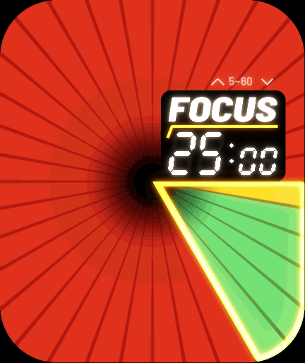

# 뽀모도로 (pomodoro)

REDMI Watch 6 글로벌(`M2523W1`, 펌웨어 `3.200.085`, 화면 432×514)용 Vela JS 퀵앱입니다. 집중과 5분 휴식을 반복하는 타이머입니다. 집중 시간은 기본 25분이고, 대기 화면에서 5~60분으로 바꿀 수 있습니다.

- 패키지: `com.hun4175.pomodoro` · 버전 `0.1.5` (versionCode 6)
- 산출물: [`dist/com.hun4175.pomodoro.debug.0.1.5.rpk`](dist/) (toolkit 내장 디버그 서명, 자세한 정보는 [`dist/BUILD_INFO.md`](dist/BUILD_INFO.md))
- 0.1.5는 실기기 설치·확인 전입니다.




## 기능

- **사이클**: 집중이 끝나면 5분 휴식, 휴식이 끝나면 다시 집중. 긴 휴식·세트 표시·설정 화면은 없습니다.
- **부스터 계기판 화면**: 화면 중심에서 퍼지는 원형 게이지 36칸(10°씩) 하나에 집중 30칸(빨강)과 휴식 6칸(초록, 3~5시 방향, 노란 네온 테두리, 3시 바로 아래 마지막 칸만 노랑)을 함께 표시합니다. 시간이 지나면 3시 방향 칸부터 시계 반대 방향으로 꺼집니다(집중: 3시→12시→9시→6시→5시, 휴식: 5시→3시). 켜진 칸 수는 집중이 `휴식 6칸 + ceil(남은 비율×30)`, 휴식이 `ceil(남은 비율×6)`입니다. 우상단 검정 박스에 `FOCUS`(흰색) / `REST`(노랑) 라벨, 왼쪽 끝이 중심 쪽으로 꺾인 노란 밑줄, 7세그먼트 `MM:SS`를 표시합니다. 일시정지일 때는 게이지 중심에 막대 두 개가 보입니다.
- **조작**
  - 화면을 탭하면 시작/일시정지가 바뀝니다.
  - 길게 누르면 확인 없이 바로 집중 대기로 돌아갑니다. 설정해 둔 집중 시간은 유지됩니다.
  - **대기 상태**(시작 전, 리셋 직후)에서만 시간 박스 위에 `^ 5~60 v` 힌트가 보입니다. 위로 스와이프하면 집중 시간이 5분 늘고, 아래로 스와이프하면 5분 줄어듭니다(5~60분). 60분이면 `^`가, 5분이면 `v`가 흐려집니다. 숫자는 바로 바뀌고, 이 값은 저장되어 다음에도 유지됩니다. 실행 중이거나 일시정지 상태에서는 힌트가 숨고 스와이프를 무시합니다. 휴식은 5분으로 고정입니다.
- **구간이 끝나면** `vibrate({ mode: 'long' })`를 0·500·1000ms에 총 3회 울리고, 다음 구간을 자동으로 시작합니다.
- **시간 계산**: 끝나는 시각(`Date.now()` 기준)을 저장해 두고, 남은 시간은 매번 그 시각에서 다시 계산합니다. 앱을 나갔다 들어왔을 때 여러 구간이 지났으면 그만큼 진행합니다. 상태는 `@system.storage`에 저장합니다.
- **화면 켜짐 유지**: 실행 중에는 `@system.brightness`의 `setKeepScreenOn({ keepScreenOn: true })`를 시도하고, 정지·일시정지·화면을 떠날 때 해제합니다. API가 없거나 실패해도 앱이 죽지 않게 했습니다. 이 기기에서 실제로 화면이 유지되는지는 아직 모릅니다.

게이지는 켜진 칸 수(0~36)별로 미리 합성한 전체 화면 PNG 37장(`src/common/booster/g00~g36.png`, 256색 팔레트, 합계 약 716KB) 중 하나를 **단일 `image`의 `src` 교체**로 보여 줍니다. 숫자·라벨·힌트는 투명 PNG를 `image` 몇 개로 겹칩니다. 염주 앱에서 단일 이미지 `src` 교체는 실기기에서 빠르게 동작했고, 여러 이미지 + `@keyframes`는 약 1초 지연, `image-animator`는 보이지 않았습니다. 리소스와 미리보기는 `scripts/gen-booster.py`가 디자인 기준 `docs/booster-design/v11/gen_v11.py`를 불러 생성합니다. 라벨 글꼴 Barlow Semi Condensed(SIL Open Font License 1.1)는 PNG에 구워 넣었고, 글꼴 파일은 레포·rpk에 넣지 않습니다.

## 하지 않는 것

- 소리, `audio`, `muted`, 볼륨 API는 쓰지 않습니다. 미니드럼 0.1.0에서 `muted`를 쓰니 시스템 미디어 볼륨이 0이 되는 현상을 확인한 적이 있습니다.
- 다른 앱으로 이동(`router`)하지 않습니다.

## 알려진 제약 · 미확인

**사실 (문서 또는 다른 앱의 실기기 확인)**
- 화면 기준은 **432×514** 둥근 사각형입니다.
- 진동은 `vibrate({ mode: 'long' | 'short' })`만 사용합니다. Watch 6은 `start`/`stop`을 지원하지 않았습니다(염주 앱 실기기 확인).
- [`@system.brightness.setKeepScreenOn`](https://iot.mi.com/vela/quickapp/zh/features/system/brightness.html)는 문서에 있는 API입니다.

**미확인 (실기기 확인 필요)**
- **화면이 꺼진 뒤, 또는 앱을 나간 뒤에 타이머와 진동이 계속 도는지** 모릅니다. 퀵앱 JS가 백그라운드에서 멈출 가능성이 있습니다. 지금은 재진입 때 끝시각으로 구간을 따라잡고, 실행 중에는 화면 켜짐 유지를 시도합니다.
- 이 기기에서 `setKeepScreenOn`이 실제로 화면을 켜 두는지 모릅니다.
- 저장해 둔 상태를 재진입 때 복원하는 동작은 단위 테스트만 있고, 실기기에서는 아직 확인하지 않았습니다.
- 길게 누르기 판정 시간(560ms)이 이 기기에서 손에 맞는지 모릅니다.
- **게이지 PNG(장당 약 15~23KB) `src` 교체와 숫자 이미지 교체가 1초마다 바로 반영되는지**, 투명 PNG 겹침이 미리보기처럼 보이는지 모릅니다. rpk가 약 900KB로 커져 설치·로딩 시간도 확인이 필요합니다.
- **대기 중 위·아래 스와이프**(터치 좌표 차이로 판정)가 이 기기에서 탭·길게 누르기와 잘 구분되는지는 아직 모릅니다.

## 빌드 · 테스트

```bash
cd pomodoro
npm install
npm run preview  # 아이콘, 게이지·숫자 리소스, 미리보기 PNG 다시 생성 (선택)
npm test         # node:test 단위 테스트
npm run build    # dist/com.hun4175.pomodoro.debug.0.1.5.rpk
```

`sign/` 폴더가 없으면 aiot-toolkit 내장 디버그 인증서(CN=localhost)로 서명됩니다.  
0.1.5는 릴리즈 서명을 하지 않았습니다. `npm run release`는 `dist/`를 지울 수 있어 넣지 않았습니다.

아이콘은 `scripts/gen-preview.py`, 화면 리소스·미리보기는 `scripts/gen-booster.py`(Python / Pillow)로 생성합니다.

## 설치

`.rpk`를 워치에 올리는 방법은 기기·지역·Mi Fitness 버전에 따라 다를 수 있습니다.

공식 FAQ의 **디버그 / 서드파티 앱** 안내를 참고하세요:

- [Vela Quick App FAQ](https://iot.mi.com/vela/quickapp/en/guide/other/faq.html)

서명 우회·기기에 직접 쓰는 스크립트는 제공하지 않습니다.

앱 목록에서 **뽀모도로**를 실행하면 됩니다. 화면을 탭해 시작하고, 길게 누르면 처음으로 돌아갑니다. 시작 전에 위아래로 쓸면 집중 시간이 바뀝니다.

## 라이선스

MIT. [`LICENSE`](LICENSE) 참고.

## 변경 이력

- **0.1.5**: 휴식 테두리 꼭짓점을 화면 중심으로 옮겨, 마지막 집중 칸과 첫 휴식 칸도 다른 칸과 같은 파이 조각 모양이 되도록 수정. 그 밖의 디자인·조작·타이머는 그대로.
- **0.1.4**: 계기판 색·선·글로우를 원작 느낌으로 다듬음(평평한 셀 레드, 파스텔 그린, 노란 네온 2단 헤일로, 가는 7세그먼트, 굵은 이탤릭 라벨). 휴식 테두리의 중심 쪽 끝을 뾰족하게, FOCUS/REST 밑줄 왼쪽 끝을 중심 쪽으로 꺾고, 휴식 마지막 칸(3시 바로 아래)을 노랑으로 표시. 배치·조작·타이머는 그대로.
- **0.1.3**: 화면을 사이버포뮬러 부스터 계기판 스타일로 교체. 원형 게이지 36칸(집중 30 + 휴식 6)이 3시 방향부터 시계 반대 방향으로 꺼지고, 우상단에 FOCUS/REST 라벨과 7세그먼트 시간 표시. 대기 힌트는 `^ 5~60 v`. 게이지는 미리 합성한 PNG 37장의 단일 `image` `src` 교체. 조작·타이머·진동은 그대로.
- **0.1.2**: 대기 화면에 시간 위·아래 화살표 인디케이터 추가. 집중이 줄어든 위쪽은 휴식 초록으로 채우고, 휴식 구간 위쪽은 검정으로 둠.
- **0.1.1**: 원형 링을 모래시계(화면 전체가 위에서 아래로 비워짐)로 교체. 대기 중 스와이프로 집중 시간 5~60분 설정. 링 프레임 에셋 제거.
- **0.1.0**: 첫 버전. 25/5 고정 사이클, 탭 시작·일시정지, 길게 눌러 리셋, 진동 3회, 끝시각 기준 계산, 상태 저장, 화면 켜짐 유지 시도, 원형 링 프레임.
