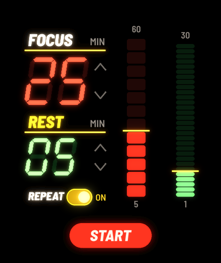
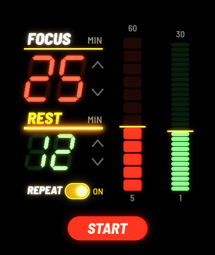
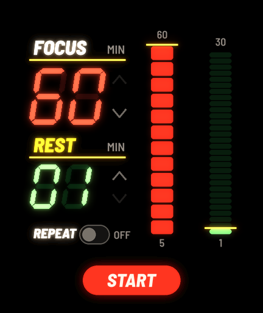

# 설정 화면 최종안 — C THERMO (온도계 막대)

setup-v3 의 C 콘셉트를 앱용으로 쪼갠 구현 패키지. 0.1.6 과 같은 **PNG 오버레이 + src 교체** 방식(동적 style 없음, `if` 로 보이기/숨기기만).
다시 만들기: `python3 gen_setup_thermo.py` (약 4초, 결정적). `../v11/gen_v11.py`, 같은 폴더의 `thermo_draw.py`(setup-v3 공통 그리기 도구를 옮긴 것), `scripts/gen-booster.py` 를 가져다 쓴다.

**0.1.7 에 적용됨.** 레이어 PNG(아래 표의 `layers/`)는 앱 리소스 폴더 `src/common/setup/` 에 바로 생성된다. 앱 빌드에서는 `scripts/gen-booster.py` → `scripts/gen-setup.py` 가 이 모듈을 import 해 같은 결과를 만들고, `layout.json`·`touch-zones.json` 을 `scripts/setup-layout.json`·`scripts/setup-touch-zones.json` 으로 복사한다.

구현 메모: 막대 칸 판정은 `touch-zones.json` 의 `focusBands`/`restBands`(칸 사이 틈의 가운데가 경계)를 그대로 따른다. 아래 식 `ceil((384 - y) / 칸 간격)` 과는 경계가 틈의 절반(집중 2px, 휴식 1px)만큼 다르다.

| 기본 25/5 | 휴식 막대를 끄는 중(12분) | 반복 끔 + 끝값(60/1) |
|---|---|---|
|  |  |  |

터치 영역: `touch-zones.png` / `touch-zones.json`

## 조작(전부 세로)
1. **막대(큰 조정)**: 막대를 짚으면 그 높이 칸으로 바로 스냅, 짚은 채 위아래로 끌면 칸마다 따라간다. 왼쪽 숫자가 실시간으로 바뀌어 값을 읽어 준다(바꾸는 줄 밑줄이 밝아짐 = `fHot`/`rHot`).
   - 집중: `k = clamp(ceil((384 - y) / 26), 1, 12)`, 값 = 5·k 분
   - 휴식: `k = clamp(ceil((384 - y) / 10), 1, 30)`, 값 = k 분
   - 막대 영역 밖(위/아래)으로 끌어도 터치가 막대에서 시작했으면 계속 추적하고 끝값에서 멈춘다(clamp). 칸별 정확한 y 경계는 `touch-zones.json` 의 `barMapping.focusBands/restBands`.
2. **숫자(미세 조정)**: 큰 숫자 칸의 **위쪽 반 탭 = +1단계**, **아래쪽 반 탭 = −1단계**(집중 ±5, 휴식 ±1). 오른쪽 작은 ▲▼ 가 단서이고 누르는 동안 `xUp-on`/`xDn-on` 을 켠다(약 150 ms). 숫자 칸에서 위/아래로 쓸어도 된다: 36px 마다 한 단계, 위로 = +.
3. **끝값**: 더 못 가는 쪽 ▲/▼ 에 불투명 패치 `xUp-off`/`xDn-off` 를 켜서 흐리게. 값은 clamp(되돌아가지 않음).
4. **방향 잠금**: 움직임이 12px 를 넘는 순간 `|dy| > |dx|` 가 아니면 그 터치는 값 변경에 쓰지 않는다. 가로 처리는 아무것도 없다.
5. **탭 판정**: 이동 ≤ 40px(`TAP_MAX_MOVE`). 저장(`saveSettings`)은 손 뗄 때 한 번.
6. 반복 줄 탭 = 토글, START 탭 = 시작(누르는 동안 `start-on` 선택).

## 레이어(아래→위, 좌표는 `layout.json`)
| 노드 | src | 규칙 |
|---|---|---|
| `bg` | `bg.png` (256색) | 항상. 라벨·밑줄·MIN·작은 ▲▼·막대 꺼진 칸·눈금(60/5, 30/1)·REPEAT 글자·START |
| `fBar0`, `fBar1` | `fg01m~fg06m`, `fg06` | 집중 막대 6칸 묶음 2개(fBar0 아래). 아래 표 참고 |
| `rBar0`~`rBar2` | `rg01m~rg10m`, `rg10` | 휴식 막대 10칸 묶음 3개 |
| `f1`,`f2` / `r1`,`r2` | `f0~f9` / `r0~r9` | 십의 자리 / 일의 자리(05 → `f0`,`f5`) |
| `fUpOff` `fDnOff` `rUpOff` `rDnOff` | `*-off.png` | 끝값일 때만 `if` |
| `fUp` `fDn` `rUp` `rDn` | `*-on.png` | 미세 조정 누르는 동안만 `if` |
| `fHot`, `rHot` | `fHot.png`, `rHot.png` | 그 값을 바꾸는 동안(막대 끌기·숫자 탭)만 `if` |
| `tog` | `tog-on` / `tog-off` | 반복 |
| `start` | `start-on` | (선택) 누르는 동안 |

**막대 묶음 규칙** (집중 n=6, 휴식 n=10; 레벨 L = 켜진 칸 수): 묶음 g 에서 `k = L − g·n`
- `k ≤ 0` → 숨김(`if` false)
- `1 ≤ k ≤ n` → `{p}g{k:02d}m.png` (k칸 켜짐 + 맨 위 노란 네온 눈금)
- `k > n` → `{p}g{n:02d}.png` (꽉 참, 눈금 없음)

모든 묶음 노드가 같은 파일을 쓰고 CSS `top` 만 다르다(집중 156px, 휴식 100px 간격). 그래서 막대 42단계를 이미지 22장으로 표현한다.

## 크기
`layers/` 52개, 약 334 KB (0.1.6 `src/common/setup` 은 약 252 KB).
- 큰 숫자 20장이 약 198 KB로 대부분이다. 0.1.6 과 같은 크기·글로우.
- 막대 묶음 22장은 약 80 KB.
- 줄여야 하면 오버레이를 팔레트 PNG(RGBA→256색+tRNS)로 저장하면 절반 가까이 줄어든다. 단, 기기 디코더에서 tRNS 지원을 먼저 확인해야 한다.

## 터치 영역 (px, `[x0, y0, x1, y1)`)
| 영역 | 좌표 | 크기 | 동작 |
|---|---|---|---|
| focusNum | 40,60 – 216,210 | 176×150 | 부모(숫자 칸 스와이프) |
| focusNumUp | 40,60 – 216,135 | 176×75 | 탭 +5 |
| focusNumDown | 40,135 – 216,210 | 176×75 | 탭 −5 |
| restNum | 40,220 – 216,350 | 176×130 | 부모 |
| restNumUp | 40,220 – 216,285 | 176×65 | 탭 +1 |
| restNumDown | 40,285 – 216,350 | 176×65 | 탭 −1 |
| focusBar | 226,56 – 306,404 | 80×348 | 짚기/끌기 = 높이로 스냅(5–60) |
| restBar | 322,56 – 402,404 | 80×348 | 짚기/끌기 = 높이로 스냅(1–30) |
| repeat | 40,358 – 216,414 | 176×56 | 탭 = 반복 토글 |
| start | 112,424 – 320,496 | 208×72 | 탭 = 시작 |

- 41쌍 검사, 겹침 없음.
- 부모 영역은 자기 Up/Down 만 품는다.
- 모든 영역이 반경 80 안쪽이고, x<30 에는 영역이 없다.
- 간격: 집중↔휴식 숫자 10px, 숫자↔막대 10px, 막대↔막대 16px, 반복↔START 10px.

## 실기기에서 확인할 것
- 막대 위 끝(y≈56)에서 아래로 끄는 동작을 시스템 내려 끌기가 가로채지 않는지.
- 비스듬히 오른쪽으로 끌 때 뒤로가기가 나는지.
- 휴식 막대 칸 높이 10px: 짚기는 대략, 정확한 값은 숫자 탭(±1)으로 맞춘다는 흐름이 자연스러운지.
- 끌 때 src 교체(묶음 3개 + 숫자 2개)가 버벅이지 않는지.
