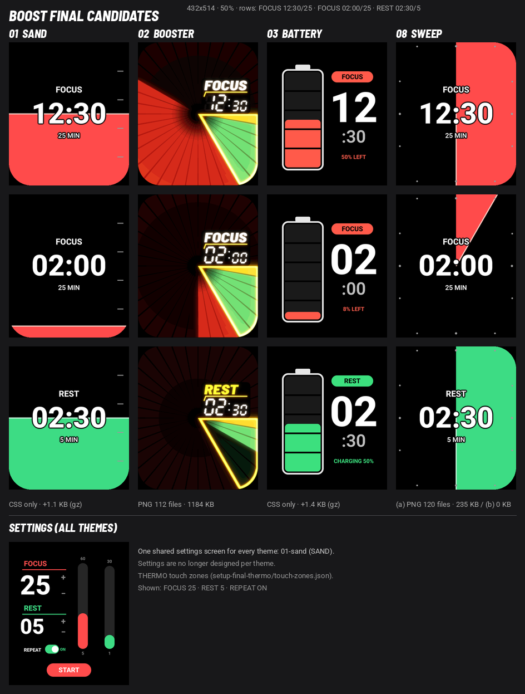

# BOOST 전체 화면 테마 시안 (8종)

> **0.1.9 구현 (2026-11-27):** 앱에는 01 SAND(기본) · 02 BOOSTER(0.1.8 PNG 게이지 그대로) · 03 BATTERY · 08 SWEEP 4종이 들어갔고,
> 설정 화면은 모든 테마 공통으로 `settings-merged/A-final`(TWIN TUBES, `A-final/touch-zones.json`)을 쓴다. 위의 THERMO 설정 설명은 시안 당시 기록이다.
> SWEEP은 (b) CSS `transform: rotate`가 기본이고, (a) PNG 60프레임(`08-sweep/assets`)은 `scripts/sweep-mode.py frames`로 바꾸는 대체 경로다.
> **0.1.10:** 테마 순서를 1 SWEEP(기본) · 2 SAND · 3 BATTERY · 4 BOOSTER로 바꿨다(저장값은 이름이라 기존 선택 유지).
> 레포에는 01 · 03 · 08 · `settings-merged/A-final`과 이 README · `themes.json` · `gen_full_themes.py` · `overview-final.png`만 올렸다(나머지 시안 폴더와 이미지는 로컬 기록).

REDMI Watch 6 (432×514, 모서리 반경 80, OLED). 테마마다 **타이머 레이아웃 · 게이지 표시 방식 · 색 · 글자 느낌**을 통째로 바꾼다.
설정 화면은 모든 테마가 THERMO 구조를 그대로 쓴다(세로 막대 2개, 세로 조작만, x<30 터치 없음, 큰 숫자 위/아래 반 탭 = ±1단계,
REPEAT 토글, START). **터치 영역은 `setup-final-thermo/touch-zones.json` 과 완전히 같다** — 테마를 바꿔도 터치 로직은 그대로.


**최종 후보 비교 (사용자가 고른 01·02·03 + 08 SWEEP):** `overview-final.png` (06 TOMATO · 07 VISUAL 은 폴더째 보관, 비교에서 뺌)

> **설정 화면 결정 (워치 개발, 2026-11-27):** 설정 화면은 테마별로 만들지 않는다. **모든 테마가 01 SAND 설정 화면 하나**
> (`01-sand/settings.png`, THERMO 터치 영역)를 쓴다. 그래서 08 은 타이머 화면 3장만 있고, `overview-final.png` 의 설정 줄은
> 열마다가 아니라 "SETTINGS (ALL THEMES)" 한 칸이다. 02~07 폴더의 `settings.png` 는 이전 시안 기록으로만 남겨 둔다.



| # | 이름 | 한 줄 콘셉트 | 구현 | 리소스 | 패키지 증가(추정) |
|---|---|---|---|---|---|
| 01 | **SAND** (모래시계 채움, 초안) | 초안 0.1.1 그대로: 화면 전체가 집중 빨강·휴식 초록으로 가득 찼다가 위에서부터 비워진다. 수위선·눈금·라벨을 더해 다듬음. | CSS만 | 이미지 0 | 약 1.1 KB (gzip) |
| 02 | **BOOSTER** (부스터, 현재) | 지금 앱: 레이싱 계기판식 36칸 파이 게이지(집중 30·휴식 6), 노란 네온 테두리, 7세그먼트 숫자. | PNG | 타이머 60장 879 KB(게이지 프레임 37장) + 설정 52장 334 KB = 112장 1,213 KB | 현재 그대로(0.1.8 rpk 1,281 KB 의 대부분) |
| 03 | **BATTERY** (배터리) | 집중은 배터리를 쓰고(빨강이 줄어듦), 휴식은 충전한다(초록이 차오름). 5칸 배터리와 오른쪽 큰 숫자. | CSS만 | 이미지 0 | 약 1.4 KB |
| 04 | **SWISS** (스위스 타이포) | 그림 없이 글자로만: 화면 절반을 채우는 큰 분 숫자, 색 블록 라벨, 바닥의 가는 진행선. 조용한 포스터 느낌. | CSS만 | 이미지 0 | 약 1.2 KB |
| 05 | **LCD** (레트로 LCD) | 80년대 전자시계: div 로 만든 7세그먼트 숫자와 꺼진 칸이 비치는 LCD, FOCUS/REST 표시등, 10칸 배터리식 진행 막대. | CSS만 | 이미지 0 | 약 2.4 KB |
| 06 | **TOMATO** (토마토 주방 타이머) | 시릴로의 원조 토마토 타이머: 0~55 숫자가 찍힌 60분 다이얼, 아래 고정 ▲ 핀, 위 꼭지·별 모양 잎. 남은 분만큼 흰 눈금이 핀에서부터 켜지고, 휴식은 초록 토마토. | CSS만(회전 없음) | 이미지 0 | 약 3.5 KB |
| 07 | **VISUAL** (사각 비주얼 타이머) | 사용자 사진의 사각 비주얼 타이머: 연분홍 베젤 안 흰 다이얼, 12시 0부터 시계 방향 0~55·60분 눈금, 남은 시간만큼 빨간 부채꼴(휴식 초록)이 줄고 가운데 분홍 노브에 남은 시간. | CSS + PNG | (a) 부채꼴 프레임 집중 60 + 휴식 30 + 다이얼 1 = 91장 194 KB | 약 194 KB + CSS 1.7 KB(gz) / (b) 회전안이면 PNG 4장 약 33 KB |
| 08 | **SWEEP** (부채꼴 스윕) | SAND 생김새 + VISUAL 움직임: 검정 바탕을 집중 빨강·휴식 초록이 화면 끝까지 채우고, 12시에서 시계 방향 부채꼴로 줄어든다(한 바퀴 = 세션 길이). 가운데 큰 흰 MM:SS, 위 FOCUS/REST, 아래 25 MIN, 둘레 점 눈금 12개. 설정은 01 SAND 공통. | (a) PNG 또는 (b) rotate | (a) 120장 235 KB / (b) 이미지 0 | (a) 약 235 KB / (b) CSS 약 1 KB |

"패키지 증가"는 테마의 template + style 조각(`NN-name/theme.ux.txt`, 생성기가 요소 목록에서 만든 것)의 gzip 크기다
(rpk 는 zip). 상태를 바꾸는 JS(바인딩 계산)는 테마당 대략 1~2 KB 더 든다고 본다 [PLACEHOLDER: 실제 구현 후 측정].
CSS 테마는 게이지 상태 수와 상관없이 **프레임 PNG 가 없다**(높이·너비·색 값을 계산해 바인딩). BOOSTER 를 빼고 CSS 테마만 남기면
rpk 는 0.1.1(16.8 KB) 수준으로 줄어든다. BOOSTER 를 테마 하나로 남기면 지금 크기 + CSS 테마 몇 KB.

## 폴더

- `NN-name/focus-mid.png` 집중 12:30 (25분), `focus-late.png` 집중 02:00 (25분), `rest.png` 휴식 02:30 (5분),
  `settings.png` 설정(집중 25, 휴식 5, REPEAT ON) — 모두 실제 크기 432×514.
- `NN-name/elements.json` (CSS 테마) 화면별 요소 목록: 위치·크기·색·radius·border·글자 + `bind`(무엇을 바인딩하는지).
- `NN-name/theme.ux.txt` (CSS 테마) 위 요소를 template + class CSS 로 옮긴 조각(그대로 붙이는 코드가 아니라 크기 추정·참고용).
- `themes.json` 6개 합본(구현 방식, 크기, 요소 수, 모서리 검사), `overview.png` 01~05 비교, `overview-final.png` 01·02·03·06 비교(50% 축소, 라벨, 행 = focus-mid / focus-late / rest / settings).
- `07-visual/` 는 PNG 리소스가 있는 테마: `assets/sector-focus/f01~f60.png`, `assets/sector-rest/r01~r30.png`, `assets/dial.png`, `assets/rotate/half-*.png`(안 b), `layout.json`(좌표·크기·측정값), `focus-mid-dark.png`(OLED 어두운 변형 참고).
- `06-tomato/reference/` 참고 사진 2장 + `SOURCES.md`(출처·라이선스). 생성기가 쓰지 않는 손 복사 파일.
- `gen_full_themes.py` 생성기. `python3 gen_full_themes.py` (결정적 — 두 번 돌려 md5 같음 확인).

## Vela CSS 근거 (레포에 이미 있는 것만 씀)

레포 `.ux` 전체(pomodoro 모든 커밋 + yeomju)에서 쓰는 속성만 썼다:
`position: absolute`, `left/top/right/bottom`, `width/height`, `background-color`, `border-width`, `border-color`, `border-radius`,
`color`, `font-size`, `font-weight: bold`, `text-align`, `text-shadow`(검정 4방향 외곽선), flex 정렬, `opacity`.
동적 값은 `style="height: {{h}}px; background-color: {{c}};"` 식 바인딩 — 0.1.1(이 방식, 당시 실기기 미확인)과
**yeomju**(README 에 REDMI Watch 6 실기기 동작 확인) 가 left/top/width/height/opacity/color 를 이렇게 바꾼다.
안 쓴 것: transform(회전·기울임), gradient, clip, 커스텀 글꼴(`font-family`/@font-face), `@keyframes`(yeomju 에서 약 1초 지연 확인).

## 테마별 구현 메모

1. **SAND** — 0.1.1(`git show 44ca888:pomodoro/src/pages/index/index.ux`)의 `.sand` div(바닥 고정, `height = round(남은/전체 × 514)`,
   색 `#FF4B4B`/`#3DDC84`, 일시정지는 0.1.1 의 어두운 색 `#8A3A3A`/`#2A6B4A`)를 그대로 쓴다. 다듬은 것: 수위선 div 4px(밝은 같은 색,
   `top = 514 − height − 2`), 오른쪽 20% 눈금 4개(고정 회색), 숫자 위 FOCUS/REST 라벨, 아래 전체 길이("25 MIN"). 숫자·라벨은 0.1.1 과 같은
   text-shadow 검정 외곽선이라 색 위·검정 위 모두 읽힌다. 설정: 둥근 트랙 + 채움 div(height) 막대.
   요소: 타이머 9개 / 설정 24개.
2. **BOOSTER** — 지금 `src/common/booster`, `src/common/setup` 리소스를 앱 순서대로 겹친 미리보기(읽기만 함). 변경 없음.
3. **BATTERY** — 배터리 외곽 div(border 6px, radius 22) + 캡 + 채움 div(height/top/색) + 위에 고정 검정 칸막이 4개(5칸으로 보임).
   집중: 채움 = 남은 비율, 휴식: 채움 = 지난 비율(충전). 오른쪽에 구간 색 알약 라벨, 큰 분(150px), 초, "50% LEFT"/"CHARGING 50%".
   설정: 막대 2개를 작은 배터리 모양으로(집중 칸막이 11개 = 12단계, 휴식 5개 = 5분마다). **안쪽 채움 영역을 THERMO 막대 영역
   (y 76/86~384)과 똑같이 맞춰** 터치 공식을 바꾸지 않아도 된다. 요소: 타이머 13 / 설정 44.
4. **SWISS** — 구간 색 블록 + 검정 글자 라벨, 250px 분 숫자, 회색 초, 바닥 진행선(`width = 남은/전체 × 336`, 5등분 칼금).
   설정: 4px 가는 트랙 + 10px 채움 + 흰 손잡이 div(top), 각진 토글·START. 요소: 타이머 11 / 설정 28.
5. **LCD** — 숫자 4자리를 div 세그먼트(각 7개)로 만들고 `background-color` 만 켜짐색/꺼진 칸색으로 바꾼다(기울임 없음).
   집중 호박색 `#FFB020`, 휴식 시안 `#36E0FF`, 꺼진 칸이 어렴풋이 비침. 위 표시등 FOCUS/REST(켜진 쪽만 색), 아래 10칸 진행 블록.
   설정: 큰 숫자도 세그먼트 div, 막대는 THERMO 와 같은 칸(집중 12, 휴식 30) div. 요소: 타이머 45 / 설정 87(가장 많음).

6. **TOMATO** — 아래 "06 TOMATO" 참고. 요소: 타이머 124 / 설정 82. (사용자가 말한 원본이 이게 아니어서 보관만.)
7. **VISUAL** — 아래 "07 VISUAL" 참고. 요소: 타이머 9 / 설정 67. (08 로 개선, 보관.)
8. **SWEEP** — 아래 "08 SWEEP" 참고. 요소: 타이머 16(프레임 image 1 + 점 12 + 글자 3). 설정 없음(01 SAND 공통).

## 06 TOMATO — 원조 토마토 타이머를 CSS 로

### 참고한 원본 (실제 URL)

| 출처 | 가져온 특징 |
|---|---|
| 사진 https://upload.wikimedia.org/wikipedia/commons/3/34/Il_pomodoro.jpg (페이지 https://commons.wikimedia.org/wiki/File:Il_pomodoro.jpg, Francesco Cirillo, CC BY-SA 3.0 — 위키백과 "Pomodoro Technique" 사진) | 빨간 몸통, 5분마다 흰 숫자·큰 눈금 / 1분마다 작은 눈금, 0 오른쪽이 5(숫자가 시계 반대 방향으로 커짐), 위·아래 사이 어두운 홈, 0 아래 고정 흰 ▲ 핀, 짙은 초록 별 모양 꽃받침 |
| 사진 https://upload.wikimedia.org/wikipedia/commons/0/00/Timer_-_Musei_del_cibo_-_Pomodoro_-_252.jpg (페이지 https://commons.wikimedia.org/wiki/File:Timer_-_Musei_del_cibo_-_Pomodoro_-_252.jpg, CC BY-SA 3.0) | "최대 60분, 시계 방향 작동" → 한 바퀴 = 60분(숫자 0~55 열두 개), 분 점 눈금, 앞쪽 ▲ 핀, 초록 꼭지 |
| https://interfacelineage.com/pomodoro-tomato-timer | 윗부분을 시계 방향으로 돌려 감으면 돌아오며 째깍거리고 0에서 울린다 → 남은 시간 = 핀이 가리키는 눈금까지 |
| https://motamem.org/wp-content/uploads/2022/03/The-Pomodoro-Technique-by-Francesco-Cirillo.pdf (시릴로 책) | "The time remaining should always be visible" → 다이얼 + 가운데 큰 MM:SS 를 함께 보여 줌 |
| https://www.tfa-dostmann.de/en/product/analogue-kitchen-timer-tomato-38-1005/ , https://www.deksels.eu/en/tomato-kitchen-timer.html | 시판 토마토 타이머도 최대 60분 다이얼 |

사진 두 장은 `06-tomato/reference/` 에 있다(출처 `SOURCES.md`).

### 화면

- 몸통: 원 div(지름 368, 중심 216,282), 집중 `#E5392B`, 휴식 `#2E9B44`(초록 토마토 — 구간 구분). 안쪽 홈: border 3px 원(지름 272).
- 다이얼: **절대 60분 눈금**(원본처럼). 0 = 6시 방향 고정 ▲ 핀 바로 위, 숫자가 시계 반대 방향으로 커져 15 = 3시, 30 = 12시, 45 = 9시.
  눈금 점 60개(반지름 152, 5분마다 지름 14 / 1분마다 8), 숫자 0~55 열두 개(반지름 120, 22px, 똑바로 선 글자).
- 남은 시간: 남은 분(올림) = 켜진 점 수. 0 부터 남은 분까지 점이 흰색, 나머지는 어두운 색(`#8E1E14` / `#155C25`).
  숫자도 남은 범위 안은 흰색, 밖은 흐린 색. 12:30 → 0~13 점, 02:00 → 0~2, 휴식 02:30 → 0~3. 1분마다 점 하나가 꺼지며
  핀 쪽으로 줄어든다 — 원본에서 윗부분이 핀 쪽으로 돌아오는 모습을 "고정 다이얼 + 줄어드는 흰 호"로 바꾼 것.
- 핀: 가로 막대 div 5줄(폭 4·8·12·16·20, 높이 3)로 만든 ▲. 꼭지: 줄기 div + 꽃받침 가운데 타원 + 뾰족한 잎 5개
  (잎 하나 = 점점 작아지는 원 div 8개 사슬 — 원만으로 아무 각도나 그릴 수 있어 회전이 필요 없다).
- 가운데: FOCUS/REST(26px), MM:SS(68px), "25 MIN". 1초마다 바뀌는 건 시간 글자 하나뿐, 눈금·숫자 색은 1분에 한 번.
- 설정: THERMO 터치 영역 그대로. 빨강/초록 막대(트랙 + height 채움) 위에 5분 간격 흰 점(다이얼 눈금 느낌), 흰 큰 숫자,
  빨간 START 알약 위에 작은 꼭지(장식, start 영역 안).

### 부채꼴을 왜 매끄럽게 줄이지 않았나 (정직한 판단)

- Vela CSS 로 부채꼴을 그리려면 회전(`transform: rotate`)한 반원 두 장을 겹치고 반쪽을 가리는 방식(`overflow: hidden`) 이 필요하다.
  conic-gradient·clip-path 는 없다. Vela 문서(https://iot.mi.com/vela/quickapp/zh/components/general/animation-style.html)는
  `transform: rotate` / `transform-origin` 을 지원한다고 하고, 동적 transform 은 `JSON.stringify({rotate:"10deg"})` 로 넣는다
  (https://iot.mi.com/vela/quickapp/zh/tools/toolkit/update.html). 하지만 **이 레포의 어떤 .ux 도 transform 을 쓴 적이 없어
  REDMI Watch 6 에서 검증되지 않았고**, 반원을 가리는 overflow 자르기도 미검증이라 시안 기본안에서 뺐다.
- PNG 프레임 방식(지금 BOOSTER 처럼)은 가능하지만 이 테마의 장점(이미지 0)을 잃는다.
- 그래서 **실기기에서 확인된 기능만**(위치 div, border-radius 원, background-color/color 바인딩) 쓰는 "분 눈금 60개" 를 골랐다.
  원본 다이얼 자체가 1분 눈금이라 1분 단위 줄어듦은 원본에 충실하다. 매끄러운 부채꼴이 꼭 필요하면 기기에서 rotate 를 먼저
  시험해 보고(반원 2장 + 가림 1장, 요소 3개), 되면 흰 점 대신 밝은 부채꼴로 바꿀 수 있다 [PLACEHOLDER: rotate 실기기 확인].

## 07 VISUAL — 사용자 사진의 사각 비주얼 타이머

사진(사용자가 워치 개발에 보낸 것, 파일은 받지 못해 설명으로 받음)의 특징을 옮겼다. 상표·로고·모델 표기('2.0' 등)는 넣지 않았다.

| 사진 | 화면 |
|---|---|
| 연분홍 두꺼운 베젤의 둥근 사각 본체 | 화면 배경 전체 = 베젤 `#F3B2AA`(둥근 화면이 모서리를 자름). 아래 가운데 작은 탭 = 진한 분홍 div 60×10 |
| 안쪽 흰 둥근 사각 다이얼 | 흰 div (18,58) 396×396, radius 56 |
| 60분 눈금, 0 이 12시, 시계 방향으로 커지는 0~55 검정 숫자, 5분 긴 눈금·1분 짧은 눈금, 숫자는 눈금 원 바깥 | 고정 PNG `assets/dial.png` 1장 (눈금 반지름 126/135~147, 숫자 반지름 171, 0 옆 시계 방향 화살표 포함) 374×365, 29,029 B. 눈금이 사선이라 CSS 로는 회전 없이 못 그려 PNG 로 둠 |
| 0 에서 시계 방향 빨간 부채꼴, 눈금 원 안쪽에서 노브 근처까지 | 중심 (216,256), 반지름 122 부채꼴. 집중 빨강 `#E8322B`, 휴식 초록 `#2FA84F`. **절대 60분 다이얼**(1분 = 6°): 12:30 → 13분(78°), 02:00 → 2분, 휴식 02:30 → 3분 |
| 가운데 본체 색 둥근 노브 | 분홍 원 div 지름 108 + 진한 분홍 테두리 3px, 그 위에 남은 시간 MM:SS(27px, 진한 갈색) |
| — | FOCUS/REST 는 다이얼 밖 위쪽 베젤에 작게(구간 색 점 + 글자) |

**설정 화면**: THERMO 터치 영역 그대로(10개 모두 같음). 분홍 베젤 + 흰 판, 검정 큰 숫자, 연회색 트랙 + 빨강/초록 채움 막대, 막대 오른쪽에 다이얼 같은
검정 눈금(집중 5분마다, 휴식 1분 짧게·5분 길게), 초록 토글, 판 아래 베젤에 빨간 START.

**OLED**: 사진 느낌(분홍 베젤 + 흰 판)을 기본안으로 했다. 화면 대부분이 밝게 켜져 배터리를 많이 쓰고 밤에 눈부실 수 있다.
그래서 검정 베젤 + 짙은 회색 판 + 흰 눈금 변형을 `focus-mid-dark.png` 로 하나 그려 뒀다(다이얼 PNG 는 `assets/dial-dark.png`, 33,007 B).

### 구현안 (a) PNG 부채꼴 프레임을 image src 로 교체 — 실제로 렌더링해 잰 값

- 프레임: 분 단위. 집중 `f01~f60` 60장, 휴식 `r01~r30` 30장(휴식 최대 30분). 0분이면 image 를 숨김.
  `src = ceil(남은 초 / 60)` 번 프레임. 1분에 한 번 6°씩 줄어든다.
- 저장: 같은 image 노드에서 src 만 바꾸므로(앱 규칙, `scripts/gen-booster.py` union_box) 모든 프레임을 **부채꼴 원의 bbox 하나**
  (left 94, top 134, 244×244)로 잘랐다. 앱 글자 레이어처럼 RGBA PNG, `optimize=True`, 팔레트 없음. 색은 단색, 모양은 알파(가장자리 안티에일리어싱)만.
- **측정**: 집중 60장 **124,302 B**(장당 856~3,186 B), 휴식 30장 **45,278 B**,
  다이얼 29,029 B → 합계 91장 **198,609 B (약 194 KB)**. 지금 BOOSTER 타이머 PNG(60장 879 KB)보다 작다.
  16색 팔레트로 줄이면 집중 60장 82,826 B(팔레트+투명 PNG 가 워치에서 제대로 보이는지는 미확인 [PLACEHOLDER]).
- 더 매끄럽게: 1° = 10초마다 360장(집중 60분)은 메모리에서 렌더링해 잰 값 **735,771 B(약 0.7 MB)**,
  매초 0.1° 3600장은 그 평균으로 추정 **약 7.0 MB** — rpk 로는 비현실적. 매초 부드럽게는 (b) 가 맞다.
- 휴식 길이와 무관하게 휴식 프레임은 30장이면 된다(절대 60분 다이얼이라 같은 분 = 같은 각도).

### 구현안 (b) transform: rotate — 구조 [PLACEHOLDER: 워치에서 동작 미확인]

Vela 문서는 `transform: rotate` / `transform-origin` 을 지원한다고 하고(https://iot.mi.com/vela/quickapp/zh/components/general/animation-style.html),
동적 transform 은 `JSON.stringify({rotate: "10deg"})` 로 넣는다(https://iot.mi.com/vela/quickapp/zh/tools/toolkit/update.html).
하지만 이 레포의 어떤 .ux 도 transform 을 쓴 적이 없다. 또 `overflow` 는 Vela 통용 스타일 목록(https://iot.mi.com/vela/quickapp/zh/components/general/style.html)에
없고, 모서리별 border-radius 도 없다. 그래서 **반원을 overflow 로 자르는 흔한 방식은 쓰지 않고**, 반원 PNG 3장을 회전만 시키는 구조로 했다
(다이얼 바탕이 흰색이라 흰 반원이 가림막 역할을 한다).

```
<div class="sectorWrap">                      left 94, top 134, 244×244 (자르기 없음)
  <image class="halfA" src="{{halfColor}}">    left 122, top 0, 122×244, 회전 없음.  보임: θ > 0
  <image class="mask"  src="half-white.png">  left 122, top 0, 122×244, transform-origin 0px 122px, rotate(θ).        보임: 0 < θ ≤ 180
  <image class="halfB" src="{{halfColor}}">    left 122, top 0, 122×244, transform-origin 0px 122px, rotate(θ − 180). 보임: θ > 180
</div>
(그 위에 dial.png, 노브, 글자)
```

- 각도: `θ = 남은 초 × 0.1°`(매초) — 60분 = 360°. 매분으로 하려면 `θ = ceil(남은 초/60) × 6°`.
- halfA: 0~180° 반원(오른쪽). θ ≤ 180 이면 흰 mask 가 θ~θ+180 을 덮어 0~θ 만 남는다. θ > 180 이면 halfB 가 θ−180~θ 를 칠해 0~θ 가 된다.
- 바인딩: `style="transform: {{maskRot}}"`(maskRot = JSON.stringify({rotate: θ + "deg"})), halfB 도 같은 식, 보임은 `show`/`display`. halfColor = 구간별 `half-red.png` / `half-green.png`.
- PNG: half-red 1,511 B, half-green 1,528 B, half-white 1,577 B (각 122×244) + dial. 어두운 변형이면 판 색 가림막 1장 더.
- 확인: 생성기가 이 구조를 PIL 회전으로 흉내 내 (a) 부채꼴과 비교했다(`layout.json` b_simulation: 12·75·150·179·181·250·359°에서 평균 차이 0.06~0.30/255,
  눈에 띄는 픽셀 0~5개). 실기기에서는 회전 이미지 가장자리 안티에일리어싱에 따라 경계에 얇은 선이 보일 수 있다 [PLACEHOLDER].
- 확인할 것 [PLACEHOLDER]: image 에 transform rotate 가 되는지, transform-origin 이 먹는지, 매초 transform 바인딩 갱신 지연(yeomju 는 @keyframes 에서 약 1초 지연)이 있는지.
  실패하면 (a) 로 간다.

## 08 SWEEP — SAND 생김새, VISUAL 움직임

- 생김새는 01 SAND 그대로: 검정 바탕, 집중 `#FF4B4B` / 휴식 `#3DDC84` 가 화면 끝까지(둥근 모서리 안 전체), 가운데 104px 흰 MM:SS,
  위 FOCUS/REST(30px), 아래 "25 MIN"(24px), 글자는 SAND 와 같은 검정 외곽선 text-shadow. 분홍 베젤·흰 다이얼·숫자 눈금은 없다.
- 움직임은 VISUAL: 색이 12시에서 시작해 시계 방향 부채꼴로 줄어든다. 중심은 화면 중앙 (216,257), 반지름 338
  (중앙에서 화면 모서리까지 335.7 + 여유)이라 화면 전체를 덮는다. **한 바퀴 = 설정한 세션 길이**: 시작하면 꽉 찼다가 끝나면 다 비워진다.
  움직이는 가장자리에 SAND 수위선처럼 밝은 선 4px(`#FFC9C0` / `#C4F7DA`).
- 둘레 눈금: SAND 의 얇은 눈금 대신 **점 12개**(세션의 1/12 마다, 12·3·6·9시는 8px, 나머지 6px, 회색 `#9A9A9A`). 중심에서 나간 선이 둥근 화면을
  14px 안쪽에서 만나는 곳에 둔 원 div 라 회전이 필요 없다(사선 눈금은 회전이나 PNG 가 필요해서 점으로 함).
- 미리보기: 12:30/25 → 반(180°), 02:00/25 → 5칸(30°), 휴식 02:30/5 → 반. 설정 화면은 만들지 않음(01 SAND 공통).

### 구현안 (a) 화면 전체 부채꼴 프레임 PNG 를 image src 로 교체 — 실제 렌더링해 잰 값

- 프레임은 시간 대신 **비율** 단위라 세션 길이와 상관없다: 구간마다 60장(1칸 = 세션의 1/60 = 6°), 집중 `assets/sweep-focus/f01~f60`,
  휴식 `assets/sweep-rest/r01~r60`. `src = ceil(남은 초 / 전체 초 × 60)`, 0 이면 숨김. 25분이면 25초마다, 5분이면 5초마다 한 칸.
- 저장: 같은 image 노드라 모든 프레임이 화면 전체 432×514(부채꼴이 화면 끝까지라 bbox 가 화면 전체). 검정 바탕 **불투명 RGB PNG, optimize, 팔레트 없음**
  (투명 처리 없음 — 검정 위에 바로 깐다).
- **측정**: 집중 60장 **120,097 B**, 휴식 60장 **121,022 B**, 장당 1,092~2,890 B →
  합계 120장 **241,119 B (약 235 KB)**. 16색 팔레트면 집중 60장 79,507 B
  (불투명 팔레트라 tRNS 문제는 없지만 실기기 표시 미확인 [PLACEHOLDER]).
- 더 매끄럽게: 1°마다 360장(구간당)은 메모리에서 렌더링해 잰 값 **709,846 B(약 0.7 MB)**/구간 —
  두 구간이면 약 1.4 MB 라 rpk 로는 무겁다. 매초 부드럽게는 (b).

### 구현안 (b) transform: rotate — 구조 [PLACEHOLDER: 워치에서 동작 미확인]

바탕이 검정이고 화면 밖은 어차피 안 보이므로 **반원 대신 직사각형 div** 로 된다(이미지 0, overflow 자르기 불필요).
반지름 338 안의 반평면만 덮으면 되기 때문이다.

```
(검정 바탕)
<div class="secA"  left 216, top -81, 338×676, background-color 구간 색.  회전 없음.               보임: θ > 0
<div class="mask"  같은 자리·크기, background-color #000000, transform-origin 0px 338px, rotate(θ).        보임: 0 < θ ≤ 180
<div class="secB"  같은 자리·크기, background-color 구간 색, transform-origin 0px 338px, rotate(θ − 180). 보임: θ > 180
<div class="edge"  left 214, top -81, 4×338, 밝은 색, transform-origin 2px 338px, rotate(θ). 보임: 0 < θ < 360
(그 위에 점 눈금 12개, FOCUS/REST, MM:SS, 25 MIN)
```

- θ = 남은 초 / 전체 초 × 360° (매초 갱신하면 25분 세션에서 초당 0.24°).
- 바인딩: `style="transform: {{maskRot}}"`, `maskRot = JSON.stringify({rotate: θ + "deg"})`(https://iot.mi.com/vela/quickapp/zh/tools/toolkit/update.html),
  보임은 `show`/`display`, 색은 `background-color` 바인딩(SAND 와 같음).
- 확인: 생성기가 이 구조를 PIL 회전으로 흉내 내 정확한 부채꼴과 비교했다(`layout.json` b_simulation, 30·150·179·181·270·354°: 평균 차이 0~0.08/255,
  어긋난 픽셀은 경계선 안티에일리어싱 0~72개 — 실제로는 edge 선이 덮는다).
- 확인할 것 [PLACEHOLDER]: div 에 transform rotate·transform-origin 이 되는지, 음수 top(-81)과 화면보다 큰 div 가 괜찮은지, 매초 transform 갱신 지연.
  안 되면 (a).

## 모서리 · 안전 영역

미리보기마다 둥근 화면을 4px 줄인 영역 밖에 밝은 픽셀(>40)이 있는지 검사했다(`themes.json` cornerPixelsOutside).
CSS 테마 5개(06 포함)와 07·08 은 모두 0이다(07 의 베젤 `.bezel`, 08 의 부채꼴 `.sweep` 처럼 화면 전체를 칠하는 바탕은 빼고 검사)(SAND 의 화면 전체 바탕 `.sand`/`.level` 은 일부러 가장자리까지 칠하므로 빼고 검사 — 둥근 화면이 잘라 준다).
BOOSTER 는 원래 화면 전체 게이지 그림이라 가장자리 픽셀이 있다(지금 앱 그대로). 터치 영역은 10개 모두 THERMO 와 같아 x<30 없음.

## 주의

- **글꼴 [PLACEHOLDER]**: CSS 테마 글자는 기기 시스템 글꼴로 나온다. 미리보기는 대체 글꼴 Roboto 로 그렸고 굵기를 600~900 으로
  나눴지만, CSS 에는 `font-weight: bold` 만 쓴다(기기에서 굵기 단계가 더 있는지 모름). 실제 글자 폭·높이는 달라질 수 있다.
  "−" "+" 글자는 시스템 글꼴에 없으면 div 막대로 바꾸면 된다.
- SWISS 250px, BATTERY 150px 같은 큰 font-size 가 기기에서 그대로 나오는지 미확인 [PLACEHOLDER].
- LCD 는 div 가 많다(설정 87개). 1초마다 세그먼트 색 바인딩 수십 개를 바꾸는 성능은 실기기 확인 필요 [PLACEHOLDER].
- 1초마다 style 바인딩이 바로 반영되는지는 0.1.1 당시 미확인이었다. yeomju 는 같은 방식으로 실기기 동작이 확인된 앱이지만
  뽀모도로 화면에서의 갱신 지연은 따로 확인 필요 [PLACEHOLDER].
- TOMATO 는 div 가 많다(타이머 124 = 눈금 60 + 숫자 12 + 꽃받침 42 + 핀 5 + 기타). 대부분 고정이고 1분마다 바뀌는 건 눈금 점
  1개·숫자 색 정도지만, 60개 바인딩을 매 렌더마다 평가하는 비용은 실기기 확인 필요 [PLACEHOLDER]. 꽃받침을 단색 원 몇 개로 줄이면 약 40개 줄어든다.
- TOMATO 는 25분 집중이 다이얼의 0~25(아래 오른쪽 절반 아래)만 쓴다 — 원본 타이머와 같은 절대 60분 다이얼이라 일부러 그렇게 했다.
  다이얼 전체를 구간 길이로 늘리면(25분 = 한 바퀴) 더 꽉 차 보이지만 원본 숫자 배치와 달라진다(생성기 `Tomato.ang` 한 줄로 바꿀 수 있음).
- 참고 사진(CC BY-SA 3.0)은 디자인 참고용으로만 두었다. 앱 패키지에 넣지 않는다.
- VISUAL 미리보기 글꼴(다이얼 숫자 PNG 포함)은 Roboto 로 그렸다. 숫자는 PNG 에 구워지므로 기기 글꼴과 상관없지만, 노브의 시간 글자는 시스템 글꼴 [PLACEHOLDER].
- VISUAL 은 사진처럼 절대 60분 다이얼이라 5분 휴식은 30°만 차지한다(작게 보임). 구간 길이를 한 바퀴로 늘리면 숫자 배치가 사진과 달라진다.
- VISUAL 의 흰 판·분홍 베젤은 OLED 에서 전력을 많이 쓴다 — 어두운 변형(`focus-mid-dark.png`) 참고.
- SWEEP (a) 는 칸이 60개라 25분 세션에서 25초마다 6°씩 끊겨 줄어든다. 부채꼴 가장자리가 MM:SS 글자를 지나갈 때 글자 외곽선 덕에 읽히지만 실기기 확인 필요.
- SWEEP 는 시작 직후 화면 전체가 빨강/초록으로 켜져 OLED 전력이 SAND 와 비슷하게 크다.
- 참고로 둔 폴더: `theme-design/`(색 테마), `gauge-style-design/`(게이지 방식) — 지우지 않았다.
