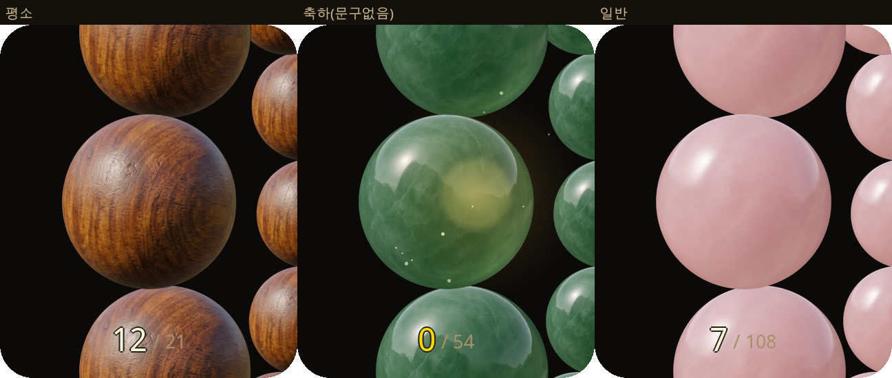
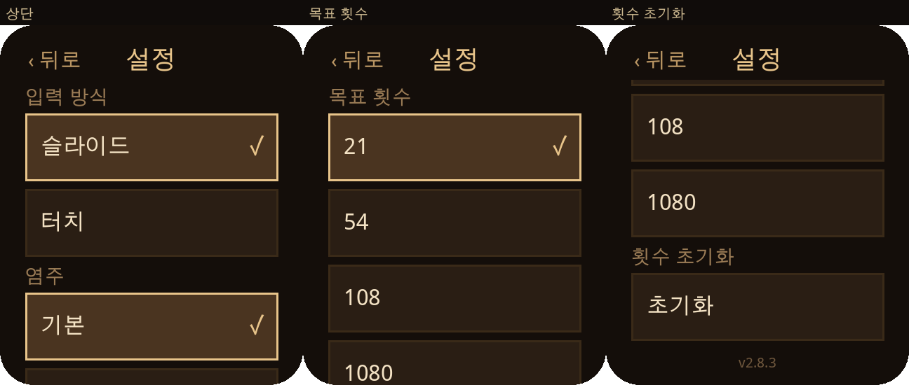

# 염주굴리기

REDMI Watch 6용 **염주 굴리기** [Vela JS 퀵앱](https://iot.mi.com/vela/quickapp/).  
화면 432×514 둥근 사각형에 맞춰, 미리 합성한 JPG 프레임으로 구슬을 굴립니다.

**현재 버전:** 2.8.4 (`versionCode` 36)  
**패키지:** [`dist/com.yeomju.mala.debug.2.8.4.rpk`](dist/com.yeomju.mala.debug.2.8.4.rpk)





---

## 기능

- **입력:** 세로 슬라이드 또는 터치로 한 알씩 굴림 (설정은 롱프레스)
- **카운트:** 하단 가운데 `현재 / 목표` 항상 표시
- **목표:** 21(기본) · 54 · 108 · 1080
- **목표 달성 시**
  - 카운트를 0으로 리셋 후 다시 집계
  - 금빛 광채 오버레이 · 카운트 반짝임
  - 진동: `vibrate({ mode: 'long' })`를 **0 · 300 · 600ms**에 총 3회
- **횟수 초기화:** 설정에서 두 번 누르면 오늘 횟수만 0 (첫 탭은 확인 안내)
- **테마 (구슬 재질):** 기본 · 옥 · 연핑크 옥

---

## 렌더링

미리 합성한 **JPG 프레임**을 단일 `<image>`의 `src`만 바꿔 재생합니다 (S2).

여러 `<image>` + `@keyframes` 방식은 실기기에서 약 **1초** 지연이 나와 배제했습니다.  
입력 제스처는 프레임 교체·축하 효과 중에도 막지 않습니다.

---

## 호환성

| 기기 | 구분 | 비고 |
| --- | --- | --- |
| REDMI Watch 6 글로벌 (`M2523W1`) 펌웨어 `3.200.085` | **사실** | 실기기 설치·동작 확인 |
| REDMI Watch 6 중국판 | **미확인** | — |
| REDMI Watch 5 | **미확인** | 화면 432×514 동일 · Vela 공식 지원 기기라 가능성 높음 |
| Xiaomi Watch 5 (`M2501W1`) | **미지원** | 글로벌 Wear OS · 원형 480×480 |

- 화면 기준: **432×514** 둥근 사각형
- 진동: `vibrate({ mode: 'long' | 'short' })`만 사용 (Watch 6은 `start`/`stop` 미지원)

---

## 빌드

필요: Node.js 18+, npm. 디버그 빌드는 toolkit 기본 인증서를 사용합니다.

```bash
cd yeomju
npm install
npm test          # node --test test/*.test.mjs
npm run build     # aiot build → dist/*.rpk
```

기타 스크립트:

| 명령 | 설명 |
| --- | --- |
| `npm start` | `aiot start --watch` |
| `npm run release` | `aiot release` |
| `npm run preview` | 링 프리뷰 (`scripts/preview-ring.mjs`) |
| `npm run sprite` | 구슬 컷 + 테마 JPG 프레임 재생성 |
| `npm run sprite:cut` | 구슬 원형 컷만 (`cut-bead-circle.py`) |

프레임 재생성 예:

```bash
npm run sprite
# 또는
python3 scripts/cut-bead-circle.py
python3 scripts/gen-theme-sprites.py
```

산출물 크기·SHA256은 `dist/BUILD_INFO.md`에 기록합니다.

---

## 설치

디버그 `.rpk`를 워치에 올리는 방법은 기기·지역·Mi Fitness 버전에 따라 다를 수 있습니다.

공식 FAQ의 **디버그 / 서드파티 앱** 안내를 참고하세요:

- [Vela Quick App FAQ](https://iot.mi.com/vela/quickapp/en/guide/other/faq.html)

서명 우회·기기에 직접 쓰는 스크립트는 제공하지 않습니다.

---

## 폴더 구조

```
yeomju/
├── src/
│   ├── manifest.json
│   ├── app.ux
│   ├── common/          # beads, ring, vibrate, sprite JPG …
│   └── pages/           # index · settings · confirm
├── scripts/             # 프레임·프리뷰 생성
├── docs/                # 화면 프리뷰 PNG
├── test/                # 단위 테스트
└── dist/                # .rpk · BUILD_INFO.md
```

---

## 버전 히스토리 (요약)

| 버전 | 내용 |
| --- | --- |
| **2.8.4** | 달성 진동 간격 300ms (0·300·600) |
| 2.8.3 | 설정 부가설명 제거 · 진동 3펄스 |
| 2.8.2 | 축하 문구 제거 · 카운트 항상 표시 |
| 2.8.1 | `현재 / 목표` · 달성 시 0 리셋 · 광채 오버레이 |
| 2.8.0 | 목표 횟수 |
| 2.7.x | 횟수 표시·초기화 · 재질 테마 |
| 2.5.x | S2 JPG 프레임 렌더 정착 |

---

## 면책 · 라이선스

비공식 개인 프로젝트이며 **Xiaomi / REDMI와 무관**합니다.  
상용·배포 전 반드시 실기기에서 검증하세요.

라이선스: [MIT](LICENSE)
